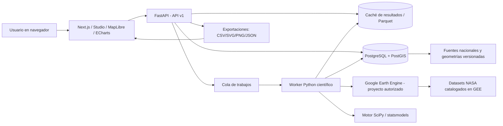

# PLAN MAESTRO — EARTH TREND STUDIO (v2.0, standalone + API/SDK)

## Plataforma web universal para explorar, cuantificar, comparar y comunicar tendencias del sistema terrestre

> **DOCUMENTO OPERATIVO PARA UN EQUIPO O AGENTE DESARROLLADOR.** No es una propuesta conceptual de una página ni un pedido de «crear un dashboard bonito». Debe guiar la construcción real de un producto interactivo, verificable y científicamente sólido. **El nombre «Earth Trend Studio» es una denominación provisional**: definir marca, dominio y logotipo antes del lanzamiento, sin llamar a la plataforma «NiñoDetect» ni asociar toda la interfaz al Fenómeno de El Niño.
>
> **Decisión cerrada:** el **MVP empleará Google Earth Engine (GEE)** para acceder y procesar los productos geoespaciales disponibles en su catálogo. No invertir tiempo ahora en reemplazar GEE por otra plataforma. Documentar, no ocultar, restricciones de cuotas, elegibilidad no comercial, latencia y futuras licencias si se expande a uso público, comercial u operativo.
>
> **Arquitectura autocontenida:** la plataforma debe adquirir los datos desde las fuentes registradas, procesarlos, validarlos, analizarlos, exportarlos y exponerlos por API **sin ejecutar ni requerir ningún notebook anterior ni archivos ZIP del estudio Trujillo**. Los notebooks son clientes opcionales de esta plataforma, no piezas de su backend.
>
> **Integración científica obligatoria:** la **web**, la **API REST** y el **SDK Python para Jupyter/Colab** usan el mismo servicio de análisis y producen resultados numéricamente idénticos para un mismo `analysis_spec`, versión de fuente y semilla.
>
> **Skills externas permitidas:** el agente implementador **puede buscar, evaluar, instalar y utilizar skills de terceros** a nivel de proyecto, sujetas a revisión de seguridad, licencia, permisos y trazabilidad.
>
> **Regla científica:** una visualización atractiva no sustituye una inferencia válida. Distinguir *tendencia*, *anomalía*, *asociación*, *capacidad de anticipación* y *atribución causal*. Nunca convertir por estética un p-valor en «probabilidad de que una hipótesis sea verdadera».

**Responsable del documento:** equipo del proyecto. **Fecha de referencia:** 14 de noviembre de 2026. **Caso demostrativo principal y opcional:** provincia de Trujillo, Perú; huaicos e inundaciones históricos y contexto de El Niño Costero. **Alcance del producto:** general, no restringido a Perú ni a desastres. **Dependencias previas:** ninguna colección de notebooks o ZIP es requerida.

---

# 0. Instrucciones innegociables para quien implemente el proyecto

## 0.1 Prioridades obligatorias

1. Construir una **herramienta general de descubrimiento de tendencias NASA**: el usuario selecciona fuente, variable, territorio, fechas, granularidad, estimador y procedimiento de inferencia.
2. Responder de forma visible a las **cuatro preguntas del challenge**: **¿qué cambia?, ¿dónde cambia?, ¿cuánto cambia?, ¿el cambio es estadísticamente significativo?**
3. Permitir explorar **series reales** con gráficos profesionales, mapas y análisis estadísticos en tiempo interactivo cuando haya caché; cuando se necesite procesamiento, exponer el progreso honradamente.
4. Permitir que el usuario **componga visualizaciones** con selección directa, arrastrar y soltar variables/paneles, comparar territorios, guardar configuraciones y exportar resultados reproducibles.
5. **Usar GEE en esta versión**, únicamente desde un backend autenticado. Nunca exponer credenciales, claves de servicio o proyecto privado en JavaScript del navegador.
6. Crear un caso guiado **«El Niño Costero y desastres en Trujillo»** mediante **un proceso de ingesta reproducible desde SINPAD/INDECI, ENFEN, cartografía oficial y NASA GEE**. El subconjunto histórico de referencia contiene 16 registros focales de ocho distritos, pero debe reconstruirse y versionarse desde fuentes de origen, no cargarse obligatoriamente desde notebooks. Este caso **no** define los menús ni el modelo de datos del producto general.
7. Ofrecer información sobre **fuentes, versión, resolución espacial, cobertura temporal, unidades, latencia, faltantes, metodología, límites de confianza y atribuciones** en cada resultado.
8. **No generar una estética genérica de dashboard producido por IA**: prohibidos el collage de tarjetas intercambiables, brillos/glassmorphism sin propósito, gráficos de relleno, degradados púrpura-azul por defecto, iconografía aleatoria y textos inflados. Diseño editorial/cartográfico propio, sobrio pero memorable.
9. No «inventar datos» para llenar vacíos. Sin dato = `null`, con explicación. Un cero medido es distinto de un faltante. **No fabricar tendencias significativas**, ni valores de precisión, ni inferencias de desastres.
10. Entregar **código funcional y pruebas**; no considerar terminado un módulo por tener maqueta, captura, README o componentes sin integrar.
11. Implementar desde el MVP **API REST pública documentada y SDK Python** para consultar fuentes, crear investigaciones, ejecutar tendencias, comparar territorios y descargar series, estadísticas, figuras y manifiestos desde Jupyter/Colab o cualquier cliente HTTP.
12. El sistema **no debe depender de notebooks, artefactos históricos ni Base64**, ni siquiera para inicializar el caso de Trujillo. Usar ingesta reproducible oficial y un script de `seed` opcional para demos verificadas.
13. El agente puede **instalar skills externas auditadas**, herramientas y dependencias adecuadas para ejecutar el plan; debe registrar versiones, procedencia y permisos, sin instalar código no revisado ni eludir autorizaciones.

## 0.2 Principios para evitar deriva de alcance

- **Producto general**: explorar cualquier variable habilitada del catálogo en cualquier territorio soportado por su cobertura y fronteras disponibles.
- **Caso de estudio**: Trujillo como «historia interactiva» destacada, no como nombre ni único modo de operación.
- **Datos NASA**: motor principal. **Fuentes nacionales** (SINPAD/INDECI, ENFEN, INEI, eventualmente SENAMHI/INGEMMET/CENEPRED) son capas especializadas, no una obligación de inventarios completos para cada país.
- **Granularidad elegible** significa escoger entre resoluciones **realmente soportadas**. No prometer clima «por calle» cuando el producto tiene píxeles de ~10–50 km.
- **Tendencia de décadas ≠ alerta del próximo día**. El modo de alertas es una extensión de investigación con evidencia, no el reclamo comercial principal.
- La aplicación web **sí se construirá por decisión de producto**, aunque el enunciado del challenge no exige específicamente React ni Streamlit: pide una herramienta que seleccione, visualice y evalúe tendencias.

## 0.3 Definición de éxito del MVP

Una persona sin conocimientos de Python debe poder, desde una interfaz pública o de demostración; en paralelo, un usuario técnico podrá automatizar lo mismo desde Python/Jupyter:

1. Elegir **Perú → La Libertad → Trujillo → distrito** o dibujar un polígono personalizado, y también cambiar a otro país soportado.
2. Elegir **precipitación NASA IMERG** o al menos tres variables NASA adicionales verificadas y disponibles en GEE.
3. Seleccionar fechas, escala temporal, agregación espacial y método de tendencia.
4. Ver **serie histórica, anomalía, tendencia con pendiente e IC correctamente asociado, significancia y mapa**; entender la unidad y la incertidumbre.
5. Cambiar el método estadístico desde el panel de análisis y comprobar que la figura y la tabla se recalculan de manera consistente.
6. Arrastrar una segunda variable a un lienzo para comparar series sincronizadas; comparar dos distritos.
7. Descargar imagen y datos con una ficha de reproducibilidad y ejecutar la **misma investigación** desde Jupyter/Colab por el SDK usando `analysis_id` o el JSON canónico.
8. Abrir el caso Trujillo/El Niño, distinguir «ocurrió durante El Niño» de «causado por El Niño» y ver tanto relaciones positivas como resultados nulos.
9. Repetir **ese mismo análisis desde un notebook Python** usando un token de API y el SDK, descargando exactamente la serie, tendencia, intervalo y diagnósticos mostrados por la web.
10. Reconocer por qué un análisis no se pudo completar si la cobertura o resolución no permite inferencias válidas.

---

# 1. Alineación exacta con el desafío NASA

**Desafío:** [Be An Earth System Trend Detective!](https://www.spaceappschallenge.org/2026/challenges/earth-system-trend-detective/).

| Pregunta del desafío | Función verificable en la app | Evidencia exportable |
|---|---|---|
| **¿Qué cambia?** | Explorador de variables NASA con históricos, anomalías y estacionalidad | Gráfica temporal, metadatos y tabla |
| **¿Dónde cambia?** | Mapa por país/provincia/distrito/ROI, comparación espacial y máscara de significancia | Mapa, escala, geometría y resolución nativa |
| **¿Cuánto cambia?** | Pendiente por año/década, diferencia estimada, cambios porcentuales cuando correspondan | Estimador, unidades, IC y código de cálculo |
| **¿Es significativo?** | Prueba apropiada, valor p, q/FDR, IC, autocorrelación, sensibilidad a método y datos faltantes | Informe de inferencia y advertencias |

**Propuesta diferencial:** un **laboratorio científico interactivo**, no un tablero rígido. El usuario experimenta con hipótesis, combina variables, define escalas, observa resultados contrapuestos, detecta artefactos y comparte una investigación reproducible. La app permite **hallazgos nulos**: «no se detecta cambio estadísticamente distinguible de cero» es una conclusión válida.

**Criterio de presentación:** centrar primero las tendencias. El caso de eventos sirve para demostrar *por qué importa* y evaluar si las anomalías coexistieron con los desastres; no dejar que una promesa predictiva eclipse la ciencia de tendencias.

---

# 2. Identidad, marca y posicionamiento

## 2.1 Producto general y caso científico: dos identidades distintas

- **Marca provisional del producto:** `Earth Trend Studio`, reemplazable. Evitar uso definitivo sin revisar disponibilidad comercial y conflictos de marca.
- **Descripción corta:** «Un laboratorio visual para investigar cómo cambia la Tierra».
- **Descriptor técnico:** «Explorador multiescala de series, mapas, anomalías y tendencias estadísticas a partir de misiones y modelos del sistema terrestre».
- **Caso demostrativo:** `El Niño Costero y los huaicos e inundaciones de Trujillo (2017–2025)`; opcionalmente etiqueta histórica del trabajo de investigación `NiñoDetect` **solo dentro del caso**.
- **Idioma inicial:** español, con estructura preparada para inglés (`es`, `en`) y separadores/unidades localizados.

## 2.2 Público objetivo y sus necesidades

| Perfil | Necesidad principal | Modo de interacción |
|---|---|---|
| Público y estudiantes | Entender fenómenos y cambios sin programar | Exploración guiada, explicación de incertidumbre |
| Científicos y analistas | Configurar métodos, revisar diagnósticos y exportar | Laboratorio avanzado y API |
| Gestores territoriales | Comparar zonas y contextualizar fenómenos | Mapas, anotaciones, informes auditables |
| Profesores y comunicadores | Narrar hallazgos visualmente | Modo presentación, historias compartibles |
| Participantes Space Apps | Reproducir el hallazgo y verificar NASA | Catálogo, proveniencia y resultados descargables |

**No convertir la aplicación en un sistema institucional de emisión de alertas oficiales**. Cualquier índice de señal experimental lleva aviso, versión, periodo de evaluación y limitaciones.

---

# 3. Alcance geográfico y resolución, sin falsas promesas

## 3.1 Jerarquía de áreas seleccionables

1. **Mundo**: panorámica global cuando el dataset tiene cobertura y el presupuesto permite preagregaciones.
2. **País**: ISO 3166-1; elegir desde buscador y mapa.
3. **Nivel administrativo 1**: departamento, estado, región o equivalente.
4. **Nivel administrativo 2**: provincia, condado o equivalente.
5. **Nivel administrativo 3 o superior**: distrito/municipio donde existan fronteras verificadas; no todos los países comparten esa estructura.
6. **Área libre:** rectángulo, círculo aproximado, polígono y GeoJSON/archivo shapefile normalizado; validar geometría, licencia y tamaño.
7. **Área de cuenca:** solo donde existan polígonos hidrológicos con origen documentado. No equivale automáticamente a distrito.

### Estrategia de fronteras

- **Global ADM0–ADM2:** usar fuente documentada como [geoBoundaries API](https://www.geoboundaries.org/api.html) (`gbOpen`, CC BY 4.0 con atribución), con edición, año, licencia y cobertura guardados por país. GEE contiene algunas colecciones de geoBoundaries, pero verificar su versión.
- **Perú y caso Trujillo:** integrar directamente una fuente de polígonos oficiales INEI/OSINFOR validada, con un **adaptador peruano autónomo** que descargue, verifique, normalice, versiona y publique los límites; no depender de geometrías incluidas en notebooks. Nunca reemplazar silenciosamente fronteras oficiales por una versión global distinta.
- Si hay solapamiento, disputa, desactualización o falta de ADM3, indicar la versión y ofrecer el nivel más alto válido.
- `geography_id` estable y versionado por sistema de fronteras; nunca unir solo por nombre de distrito.

## 3.2 Regla de resolución nativa

**El tamaño del polígono del usuario no determina la resolución del sensor.** Mostrar siempre una etiqueta junto a cada serie:

`Cobertura: [área] · Resolución nativa: [aprox.] · Escala de análisis: [escala] · Método: [promedio/total/etc.] · Píxeles útiles: N`.

Ejemplos orientativos, sujetos al producto/versionado:

- IMERG V07 ~0,1° (~11 km cerca del ecuador); útil para lluvias regionales, no para resolver un huaico en una calle.
- GLDAS ~0,25° (~28 km); puede producir datos ausentes/no representativos para polígonos distritales muy pequeños.
- MERRA-2 ~0,5° × 0,625°; análisis atmosférico de gran escala, **no** caracterización fina de microcuencas.
- MODIS NDVI: la resolución depende del producto (p. ej., 250 m en `MOD13Q1`).
- SST MODIS-Aqua: usar **una región oceánica real** frente a la costa, no asignar la temperatura del mar al polígono terrestre como si fuera una medición de cada distrito.

**Regla de validación:** si el ROI no contiene soporte espacial suficiente o no hay píxeles válidos, responder `cobertura insuficiente`; nunca extrapolarlo silenciosamente con valor del distrito vecino.

## 3.3 Granularidad temporal ofrecida

| Selector | Comportamiento esperado | Condición |
|---|---|---|
| 30 minutos | IMERG cuando el coste y volumen sean compatibles | Solo productos que lo permitan; async |
| Día | Precipitación, algunas SST y variables diarias | Cobertura real y latencia visible |
| Semana / 7–14 días | Agregación explícita | Semanas ISO o ventanas móviles, sin confundirlas |
| Mes | Base recomendable de tendencias multi-década | Todos los datasets elegidos compatibles |
| Trimestre / estación | Añadir definición de estación local | Estaciones de calendario vs climáticas |
| Año | Tendencias interanuales | Mostrar años incompletos/excluir según regla |
| Intervalo personalizado | El usuario define duración y anclaje | Bloquear inferencia si hay pocas observaciones |

**La interfaz filtra opciones no soportadas**. No crear datos diarios mediante interpolación de series mensuales como si fueran observaciones.

---

# 4. Arquitectura de información y mapa del producto

## 4.1 Secciones principales de navegación

1. **Explorar** (`/explorar`): mapa + buscador geográfico + biblioteca de variables + vista temporal.
2. **Estudio** (`/estudio`): lienzo configurable de análisis estadístico, gráficos drag-and-drop y comparador.
3. **Atlas** (`/atlas`): mapas de tendencias y panorámica espacial por variables/periodos.
4. **Historias** (`/historias`): investigaciones reproducibles, incluyendo el caso Trujillo/El Niño; no hardcodear aquí todo el producto.
5. **Fuentes** (`/fuentes`): buscador, licencias, cobertura, versiones, unidades, calidad y documentación NASA/nacional.
6. **Métodos** (`/metodos`): explicaciones, fórmulas, supuestos, glosario y limitaciones de cada inferencia.
7. **Mis estudios** (`/mis-estudios`): guardar sesiones y exportar investigaciones (inicialmente local o sesión, luego usuario registrado).

**Navegación primaria compacta**, no siete tarjetas enormes en una página de inicio. Priorizar entrada directa a «Explorar» con un ejemplo listo.

## 4.2 Tres capas de complejidad de interfaz

| Nivel | Controles visibles | Uso |
|---|---|---|
| **Esencial** | Variable, lugar, intervalo, escala, gráfico, tendencia automática | Público general |
| **Investigación** | Método, estacionalidad, autocorrelación, IC, FDR, normalización, comparaciones | Usuarios intermedios |
| **Laboratorio experto** | Bootstrap, pruebas no paramétricas, diagnóstico de residuos, cambios de régimen, sensibilidad, exportación de especificación | Científicos |

Los niveles reutilizan **el mismo motor y las mismas observaciones**; el modo esencial no usa estadísticas distintas u ocultas. Los controles avanzados deben ser accesibles sin abrir un formulario interminable.

## 4.3 Ruta de una sesión de usuario (objetivo)

1. Selecciona territorio haciendo clic en mapa o mediante buscador.
2. Arrastra `Precipitación IMERG` desde **Catálogo de variables** hacia el eje Y de un gráfico.
3. Selecciona `2003–2024`, `mes`, `acumulado mensual` y observa la serie.
4. Activa `Mostrar tendencia` y elige `Theil–Sen + IC 95 % (bootstrap temporal)`.
5. Añade `temperatura del aire` en un segundo panel y sincroniza el eje temporal.
6. Selecciona «Comparar Huanchaco vs Moche» o dibuja un ROI.
7. Abre una capa de eventos SINPAD y activa anotaciones de 2017 sin confundir coincidencia con causalidad.
8. Exporta investigación como PNG/SVG + CSV + JSON del método + ficha de fuentes.

Todo lo anterior debe funcionar con **datos reales o errores honestos de disponibilidad**, jamás con gráficos de demostración falsos presentados como NASA.

---

# 5. Especificación UX/UI: creativo, humano, editorial, sin apariencia de IA

## 5.1 Dirección de arte

**Concepto:** «observatorio científico contemporáneo» con rasgos de atlas meteorológico, editorial de datos y herramienta profesional de investigación. Inspiración general: mapas científicos, cartografía cuidada, prensa visual de datos, laboratorios de información; **no copiar el layout** de productos concretos.

- Fondo **marfil/gris hielo** en modo claro y **grafito profundo** en oscuro, evitando negro puro como única solución.
- Tipografía de lectura neutra y expresiva, números tabulares para resultados. Ejemplos a evaluar: *Inter*, *IBM Plex Sans*, *Source Sans 3* y una familia para datos monoespaciados; licencias verificadas. No se requiere entregar archivos de fuente.
- Acentos discretos inspirados en observación terrestre: **océano petróleo, verde mineral y ámbar**. **`darkorange` reservado en la capa de eventos para causalidad El Niño documentalmente verificada**, no como acento para todos los botones.
- Gráficos con paletas perceptualmente uniformes, leyendas claras, contraste WCAG AA, marcadores y tramas para daltonismo.
- Componentes con proporción editorial intencionada, alineación consistente, máximo dos familias tipográficas y una jerarquía visual clara.
- No glassmorphism gratuito, no degradado púrpura/azul omnipresente, no «AI futuristic», no esferas 3D sin función, no iconos cohete/cerebro o banners publicitarios.
- Animaciones cortas y funcionales, respetando `prefers-reduced-motion`; cero loaders infinitos, paneles saltarines o gráficos que se dibujen cada vez por estética.

## 5.2 Esqueleto de pantalla principal (desktop)

```text
┌───────────────────────────────────────────────────────────────────────────────┐
│ MARCA     Explorar  Estudio  Atlas  Historias  Fuentes        Guardar  Exportar│
├───────────────────────┬───────────────────────────────────────────────────────┤
│ 1. ÁREA Y FUENTES     │ 5. BARRA DE CONTEXTO                                 │
│ País > región > ...   │ Trujillo · 2003–2024 · mensual · IMERG · versión V07 │
│ [Buscar lugar...]     ├───────────────────────────────────────────────────────┤
│ [Mapa mini / capas]   │ 6. PANEL EDITORIAL DE EVIDENCIA                      │
│                       │ Serie temporal + tendencia + IC + eventos            │
│ 2. VARIABLES          │                                                       │
│ [Buscar datasets]     │ [comparación sincronizada / insertar panel]           │
│  ▦ Precipitación      │                                                       │
│  ▦ Temperatura        ├────────────────────────┬──────────────────────────────┤
│  ▦ Humedad            │ 7. ESTADÍSTICA          │ 8. MAPA / ANOMALÍAS         │
│  ▦ Vegetación         │ Pendiente, IC, q, N     │ Tramas, leyenda, escala     │
│                       ├────────────────────────┴──────────────────────────────┤
│ 3. FECHAS Y ESCALA    │ 9. TRAZABILIDAD: fuentes / versiones / cobertura     │
│ 4. MÉTODOS            │ [Abrir metodología] [Descargar] [Compartir]          │
└───────────────────────┴───────────────────────────────────────────────────────┘
```

**Responsive:** en móvil, pasos de selección condensados, gráfico principal a ancho completo y mapa en pestaña; no arrastrar paneles gigantes fuera de pantalla. En tablet, permitir reordenamiento por gesto, pero siempre un botón alternativo «Mover panel» accesible con teclado.

## 5.3 Controles de interacción de alto valor

| Interacción | Detalle funcional | Criterio de UX |
|---|---|---|
| **Drag & drop de variables** | Arrastrar ficha a eje Y, segundo eje (con aviso de unidades), faceta o color | Previsualización de destino y validación contextual |
| **Drag & resize de paneles** | Mover/redimensionar sin recalcular datos innecesariamente | Lienzo con cuadrícula suave y botón «Restablecer» |
| **Cross-filter / brushing** | Seleccionar un intervalo en una serie y actualizar los demás paneles/mapa | Indicar intervalo activo y forma de deshacer |
| **Comparación sincronizada** | Hasta 2–4 territorios o variables inicialmente | Ejes visibles, unidades coherentes; no dual-axis engañoso por defecto |
| **Lente estadística** | Activar pendiente, banda, anomalía, percentiles, extremos, estacionalidad | Cada superposición explica qué representa |
| **Timeline scrubber** | Mover fecha para observar mapas históricos | Sin interpolación engañosa |
| **Tooltip científico** | Fecha, valor, unidad, territorio, fuente, calidad, n de píxeles | No mostrar números con precisión artificial |
| **Undo/redo y snapshots** | Volver al último estado o guardar «escena» | Evitar pérdida de trabajo |
| **Split-view A/B** | Dos métodos, escalas o territorios con controles iguales | Comparación honesta, mostrar cambios de supuestos |
| **Narrativa guiada** | «¿Qué cambió?» → «¿Dónde?» → «¿Significa algo?» | Tutorial breve, opcional, saltable |

## 5.4 Diseño de componentes y microcopy

- `SourceCard`: nombre completo, sigla, agencia, versión, resolución, periodo disponible, sello «NASA»/«fuente nacional» correctamente acreditado.
- `GeoScopeBreadcrumb`: país > unidad administrativa > zona y geometría.
- `VariableChip`: color estable, unidad, arrastrable, botón de información.
- `ConfidenceControl`: selector `90/95/99 %`, método de intervalo, advertencia cuando no sea compatible.
- `TrendVerdict`: frases «evidencia de aumento», «evidencia de disminución», «no concluyente»; nunca «confirmado al 95 %».
- `DataQualityRibbon`: indicador de cobertura, faltantes y método de extracción.
- `EvidenceDrawer`: fórmulas, bibliografía, errores y reproducibilidad.
- `EventMarker`: forma = desastre; color = estado de atribución documental; hover muestra código y fuente SINPAD.
- `ChartToolbar`: seleccionar intervalo, reiniciar zoom, anotar, guardar PNG/SVG/CSV, copiar especificación.

Ejemplos de microcopy útil:

> «La pendiente estimada es +0,38 °C/década (IC 95 %: …). Este resultado describe el periodo seleccionado; no es un pronóstico».
>
> «No hay suficientes píxeles GLDAS para caracterizar este distrito a la resolución solicitada. Puedes elegir una región mayor».
>
> «El evento ocurrió durante un episodio ENFEN, pero **no dispone de atribución causal individual verificada**».

## 5.5 Identidad visual original: proceso obligatorio

1. Producir **dos direcciones visuales originales** en Figma u otro editor, con mapa, gráfico real y un panel estadístico, no landing pages genéricas.
2. Elegir una tras contraste de claridad, tiempo de lectura de gráficos y accesibilidad.
3. Definir tokens de color, escala tipográfica, espaciado, bordes, hover, focus y estados vacíos.
4. Implementar un prototipo con **datos de prueba explícitamente etiquetados** solo para desarrollo de UI; cambiar a NASA real antes de la demo.
5. Hacer revisión visual a 1440, 1024, 768 y 390 px. Registrar capturas antes/después y aprobar por **criterios**, no por «se ve bonito».

---
# 6. Catálogo de fuentes: NASA primero, fuentes nacionales como capas independientes

## 6.1 Política de registro de datasets

**Ninguna fuente entra en la interfaz sin contrato de datos.** Debe conocerse:

- `dataset_id` canónico en Earth Engine, `band_id`, agencia responsable, versión exacta y URL oficial.
- Fenómeno medido/modelado y significado físico (ej. SST marina ≠ temperatura del aire ≠ temperatura de suelo).
- Unidad nativa, unidad mostrada, fórmula de conversión, operación temporal válida (`sum`, `mean`, `min`, `max`, `percentile`), escala espacial de extracción y cobertura espacial.
- Inicio y fin reales de disponibilidad del producto; no deducir cobertura universal solo porque la colección exista.
- Latencia: producto retrospectivo/reprocesado vs disponible casi en tiempo real.
- Bandas de calidad, máscaras, controles de valores, fechas ausentes y política de incertidumbre.
- Restricciones de uso, atribución y fuente nacional/externa si aplica.
- Versión de la frontera administrativa y `geometry_hash` usados al extraer.

## 6.2 Fuentes NASA — primera generación (MVP)

| Grupo | Fuente / ejemplo de ID GEE | Variables prioritarias | Escala y advertencia | Implementación |
|---|---|---|---|---|
| Precipitación | `NASA/GPM_L3/IMERG_MONTHLY_V07` y `NASA/GPM_L3/IMERG_V07` | Precipitación mensual, diaria, acumulados, extremos | IMERG HH entrega tasa en **mm/h**; convertir correctamente a mm por intervalo | **P0** |
| Hidrología | `NASA/GLDAS/V021/NOAH/G025/T3H` | `SoilMoi0_10cm_inst`, `RootMoist_inst`, `Qs_acc`, `Tair_f_inst` | ~0,25°; son modeladas, no mediciones puntuales | **P0** |
| Atmósfera | `NASA/GSFC/MERRA/slv/2` | Temperatura del aire, vapor precipitable, viento / humedad cuando la banda exista | Reanálisis grueso; validar identificadores de banda al iniciar | **P0** |
| Vegetación | `MODIS/061/MOD13Q1` | NDVI/EVI y anomalías, QA | 16 días, ~250 m; filtrar QA, no tratar nubes como cero | **P0** |
| Mar | `NASA/OCEANDATA/MODIS-Aqua/L3SMI` | `sst` en ROI oceánico válido | **Producto SST MODIS-Aqua, no MUR SST**; disponibilidad y máscara oceánica | **P0 caso costero** |
| Relieve | `NASA/NASADEM_HGT/001` | Elevación, pendiente derivada, desnivel, percentiles | Estático; útil como modulador, **no** «tendencia anual de altitud» sin dataset temporal | **P1** |
| Cobertura de suelo | `MODIS/061/MCD12Q1` | Clases anuales, proporción urbana/agrícola/forestal | IGBP; leyenda oficial, cambios de clasificación y límites | **P1** |
| Superficie terrestre | MODIS LST, colección seleccionada tras verificar | Temperatura superficial terrestre, día/noche | Distinguir LST de temperatura ambiente | **P1** |
| Variables adicionales | Solo si figuran en catálogo y pasan QA | Aerosoles, radiación, incendios, nieve, evapotranspiración, etc. | Dataset-aware, no catálogo ficticio de «todo NASA» | **P2 catálogo creciente** |

**Importante:** el informe de investigación externo menciona **MUR SST**. En los notebooks finales actuales se usó **MODIS-Aqua SST**; no renombrar esa medición como MUR. Incorporar MUR en el futuro únicamente con un adaptador verificado, respetando la decisión de **procesar con Earth Engine ahora**. Nunca afirmar que una colección MUR está en GEE sin verificarlo.

### Referencias NASA/Google Earth Engine

- Catálogo general: <https://developers.google.com/earth-engine/datasets/catalog>
- IMERG V07 30 minutos: <https://developers.google.com/earth-engine/datasets/catalog/NASA_GPM_L3_IMERG_V07>
- GLDAS-2.1: <https://developers.google.com/earth-engine/datasets/catalog/NASA_GLDAS_V021_NOAH_G025_T3H>
- MERRA-2 single level: <https://developers.google.com/earth-engine/datasets/catalog/NASA_GSFC_MERRA_slv_2>
- NASADEM: <https://developers.google.com/earth-engine/datasets/catalog/NASA_NASADEM_HGT_001>
- NDVI MOD13Q1: <https://developers.google.com/earth-engine/datasets/catalog/MODIS_061_MOD13Q1>
- GEE autenticación: <https://developers.google.com/earth-engine/guides/auth>

**Punto QA:** comprobar las colecciones y bandas mediante introspección del catálogo en cada versión de software; si una banda no existe o cambia, **inhabilitar la variable y mostrar diagnóstico**, no completar con una variable distinta sin autorización científica.

## 6.3 Fuentes externas y nacionales: módulo «Contexto local»

| País / contexto | Fuente | Naturaleza | Uso en la interfaz | Precaución |
|---|---|---|---|---|
| Perú | SINPAD / INDECI | Registros administrativos de emergencias | Fechas, categoría, territorio, daños cuando estén depurados | Reporte ≠ fenómeno físico único; faltantes ≠ inexistencia |
| Perú | ENFEN | Cronología oficial de Niño/Niña Costera | Fondo temporal y estratificación de eventos | Coincidencia ENFEN ≠ causalidad individual |
| Perú | INEI / cartografía administrativa OSINFOR | Límites geográficos | Provincias y distritos con versión | Nombres/UBIGEO/versiones deben coincidir |
| Perú | INGEMMET/CENEPRED | Susceptibilidad y zonificación | Capas auxiliares cuando se licencien y validen | Riesgo/susceptibilidad ≠ evento registrado |
| Perú | SENAMHI, cuando haya datos públicos verificables | Estaciones/precipitación y otras observaciones | Contraste, no sustitución automática NASA | Permisos, unidad, cobertura y QA |
| Otros países | Adaptadores futuros | Catálogos de agencias locales | Capas opcionales por país | No afirmar cobertura global de «desastres nacionales» |
| Global | geoBoundaries (`gbOpen`) | Límites y metadatos administrativos | Selector territorial | Atribución/licencia/fecha de límites |
| Global complementaria | HydroBASINS/HydroSHEDS | Cuencas/drenaje externos, no NASA | Modificadores geográficos, caso hidrológico | No confundir flujo en celdas con caudal real |

### Política de visibilidad de procedencia

- Leyenda de fuente: **NASA**, **agencia nacional**, **cartografía de terceros** o **derivado calculado**.
- Mostrar DOI o URL, fecha de consulta, última fecha de datos, versión y transformaciones.
- Para superposiciones de desastres: estado documental de causa `verificada / no verificada / indeterminada` y vínculo a evidencia, no inferencia automática por fecha.
- No atribuir a NASA eventos SINPAD ni a INDECI las mediciones satelitales.

## 6.4 Catálogo de variables que debe ofrecer el producto por integración directa

**Esta es una lista de implementaciones requeridas; no es una dependencia de extracciones preexistentes.** El worker GEE debe construir las series desde cero, normalizar unidades, versionar el producto y registrar el resultado en el catálogo. La capa nacional se importa de fuentes oficiales por pipelines propios.

| Variable / producto | Tipo | ID canónico del catálogo |
|---|---|---|
| Precipitación IMERG mensual y diaria | Observación satelital / producto combinado | `precip_mm`, `precip_daily_mm` |
| SST MODIS-Aqua | Temperatura oceánica | `sst_modis_aqua_c` |
| Humedad GLDAS | Estado hidrológico modelado | `soil_moisture_gldas` |
| Temperatura de aire GLDAS | Temperatura modelada | `tair_gldas_c` |
| Vapor atmosférico MERRA-2 | Reanálisis | `total_precipitable_water_merra` |
| NDVI MODIS | Índice de vegetación | `ndvi_modis` |
| SINPAD/INDECI vía fuente autorizada | Eventos administrativos públicos | `sinpad_trujillo_focal` (caso, no módulo general) |

**No hardcodear estas siete variables como límite del producto ni presuponer disponibilidad de archivos locales:** construir un registro flexible de adaptadores Earth Engine. Cada nueva banda del catálogo crea variable y opciones válidas sin modificar la UI estructural.

---

## 6.5 Implementación independiente del caso Trujillo desde fuentes oficiales

No exigir `NinoDetect_Maestro_145_2017_2025.csv`, ni ZIP de resultados ni cuadernos previos. El caso debe poder reconstruirse así:

1. **Eventos:** obtener SINPAD/INDECI desde descarga pública o API **real, verificada y permitida**, conservar archivo fuente crudo y checksum, documentar fecha de extracción; si no hay endpoint estable, implementar carga administrativa de CSV público con procedencia y licencia, **no inventar endpoint ni scraping ilegal**. Normalizar peligro, provincia/UBIGEO, fecha/formatos heterogéneos; guardar código SINPAD y auditorías de duplicados. La cifra de referencia histórica (16 registros focales/8 distritos) es prueba de control, **no valor fijo de producto**.
2. **ENFEN:** importar cronología oficial de episodios con documento/versionado, evaluar coincidencia de fechas; causalidad individual = `unverified` salvo evidencia documental específica. Mantener evento + fuente de atribución + confianza documental, no inferir automáticamente.
3. **Distritos:** usar cartografía oficial con UBIGEO y CRS correcto; publicar geometry_hash, área y versión.
4. **NASA:** para cada variable registrada y área, llamar al adaptador Earth Engine propio para las series solicitadas; registrar cambios de resolución, cobertura, máscara y unidades.
5. **Geografía estática:** NASADEM, HydroBASINS y MODIS solo donde exista licencia/colección verificada; distinguir análisis distrital de cuenca aportante real. No equiparar pendiente media a pendiente de quebrada.
6. **Analítica:** calcular series, climatología, tendencias, anomalías, comparaciones y asociación con días sin emergencias por el mismo núcleo estadístico general.
7. **Historia:** publicar una configuración declarativa (`stories/trujillo-el-nino.yaml`) que solicite análisis por API en tiempo de ejecución o lea caché certificada; no depende de paths `/content`, notebooks ni Base64.
8. **Pruebas:** auditoría 2017–2025 y cobertura de fuentes; si cambia el conteo por actualización SINPAD, señalar reconciliación, nunca forzar 16 filas.

**Fallback honesto:** si la fuente nacional no permite descarga automatizada o está caída, el demo puede usar una copia pública versionada con autorización y manifiesto. Eso es un *snapshot de fuente*, no una dependencia del notebook de investigación.

# 7. Motor científico: «Laboratorio estadístico» configurable

La profundidad estadística es **una función central del producto**, no una pestaña decorativa. Separa **transformación de datos**, **estimación de cambio**, **inferencia**, **comparación** y **diagnóstico**.

## 7.1 Flujo de cálculo científico

```text
Dataset verificado + banda + metadatos + geometría versionada
  → filtrado temporal/espacial + máscara de calidad
  → agregación temporal/espacial válida (con cobertura observada)
  → serie X={t, valor, cobertura, unidad, incertidumbre_fuente?}
  → tratamiento de estacionalidad/opcional anomalía
  → selección de estadístico y supuestos
  → estimación puntual + intervalo del mismo estimador
  → contraste de hipótesis + autocorrelación + FDR cuando proceda
  → diagnóstico y pruebas de sensibilidad
  → gráfico, tabla, reporte y especificación reproducible
```

Todos los cálculos estadísticos sobre series compactas se realizan en el backend Python. **GEE realiza extracción/reducción geoespacial**, no debe ejecutar regresiones estadísticas arbitrarias complejas dentro del servidor de imágenes.

## 7.2 Selector de tipo de análisis

El usuario elige una o varias lentes:

- **Tendencia global:** magnitud/dirección durante el periodo elegido.
- **Cambio interanual y por década:** puntos iniciales/finales estimados y diferencia con incertidumbre.
- **Ciclo estacional:** climatología, amplitud, meses extremos y anomalías mensuales.
- **Variabilidad:** desviación estándar, IQR, coeficiente de variación solo donde sea interpretable, cuantiles.
- **Extremos:** proporción de periodos que superan P90/P95/P99 histórico, máximos anuales, frecuencias de extremos.
- **Puntos de cambio:** exploración de cambios de régimen; separación de algoritmo descriptivo y prueba estadística validada.
- **Asociación:** correlaciones y desfases entre variables, o con una serie de eventos externa.
- **Descomposición:** tendencia + estacionalidad + residuo (STL), con componente suavizada **no equivalente** a prueba inferencial.
- **Comparación territorial:** pendientes y diferencias entre sitios calculadas con inferencia compatible.
- **Robustez:** comparar métodos, escalas temporales y periodos de referencia.

## 7.3 Métodos de tendencia (el usuario puede elegir)

| Método | Qué dibuja | Estadístico principal | Inferencia recomendada | Cuándo utilizar / advertencia |
|---|---|---|---|---|
| **OLS lineal** | Recta ajustada | Pendiente `β₁` por tiempo | IC OLS estándar solo si supuestos; **HAC/Newey-West** para dependencia temporal | Base interpretable; revisar residuos |
| **Theil–Sen** | Recta robusta | Mediana de pendientes por pares | IC propio de Theil–Sen cuando válido, o bootstrap temporal por bloques | Robusto frente a outliers; no mezclar con IC de OLS |
| **Mann–Kendall** | Indicador de monotonicidad (la curva visual puede ser Theil–Sen) | Tau / estadístico S | Ajuste de autocorrelación o remuestreo temporal, posible versión estacional | La prueba **sin corregir no es robusta** a autocorrelación |
| **Kendall estacional** | Tendencia estacional comparada | Estadístico para estaciones | Corrección por dependencia y tamaños de muestra | Serie mensual con estacionalidad fuerte |
| **LOWESS/LOESS** | Curva suavizada | Estimación local descriptiva | Bandas por bootstrap apropiado; no p de «pendiente global» automática | Ver cambios no lineales; no confundir suavizado con causalidad |
| **GAM** | Curva suave aditiva | Función del tiempo / derivada | Banda de confianza del ajuste y derivada según modelo, diagnósticos | Patrones no monótonos; parámetros y regularización declarados |
| **Regresión segmentada** | Tramos lineales con punto(s) de cambio | Pendientes por tramo | IC del modelo incluyendo incertidumbre de quiebre cuando se estime | Cambios abruptos; controlar búsqueda múltiple |
| **STL** | Tendencia suavizada y ciclo estacional separados | Componentes descriptivas | No atribuir significancia a la curva sin prueba separada | Explicar estacionalidad |
| **Cuantílica** | Rectas/curvas para cuantiles P10/P50/P90 | Cambio en cada cuantil | IC por bootstrap compatible con dependencia | Investigar extremos/colas, distinto de media |
| **Poisson/NegBin** | Cambio en tasas de conteos | Razón de tasas / pendiente log | IC del GLM/GAM, sobre-dispersión y exposición | Frecuencia de eventos reportados, si N lo permite |

**Prohibido:** dibujar una curva polinómica de grado arbitrario solo por «ver algo no lineal» y etiquetarla como tendencia significativa. Modelos flexibles tienen riesgo de sobreajuste; si se ofrece polinomio, será **exploratorio, grado restringido, validado y rotulado**.

## 7.4 Intervalos de confianza: controles precisos

**Panel «Incertidumbre»** (avanzado):

- **Nivel:** `90 %`, `95 %` (por defecto), `99 %`, y valor personalizado entre límites razonables, validado.
- **Método:** intervalo analítico apropiado / HAC / bootstrap por bloques / bootstrap estacional / intervalos basados en remuestreo por años. **Mostrar solo métodos compatibles con la estadística elegida.**
- **Parámetros:** longitud de bloque, replicaciones (p. ej. 500, 1000, 3000, con advertencia de coste), semilla reproducible, tipo de agrupación `año / episodio / cuenca` cuando exista.
- **Sensibilidad:** observar cómo cambia el IC si la serie se calcula por mes frente a año, o si se cambia periodo de referencia.
- **Visualización:** sombra semitransparente distinguible para banda de confianza del **promedio estimado**, y banda de predicción solo si fue estimada explícitamente; nunca presentarlas como equivalentes.
- **Transparencia:** ficha `estimador puntual`, `método de IC`, `N`, `N efectivo (si estimado)`, `datos faltantes`, `supuestos` y `versión del algoritmo`.

### Por qué no hablar de «confiabilidad» como porcentaje mágico

- El `95 %` de un intervalo de confianza es una **propiedad de cobertura del procedimiento bajo supuestos**, no la probabilidad de que un parámetro fijo esté dentro del intervalo específico.
- `p < 0,05` no demuestra que una hipótesis sea verdadera en 95 %.
- `q` FDR se utiliza para **controlar la proporción esperada de falsos descubrimientos entre rechazos** bajo sus condiciones, no como «probabilidad de causalidad».
- En perfiles no expertos, reemplazar «95 % confiable» por «IC del 95 % calculado mediante [método]».
- Si el usuario elige **intervalos bayesianos creíbles** en una futura ampliación, deben etiquetarse como tales y no mezclarse con IC frecuentistas.

## 7.5 Pruebas de significancia y correcciones elegibles

| Control UI | Opciones permitidas | Reglas automáticas |
|---|---|---|
| Hipótesis | Pendiente 0; tendencia monotónica; diferencia entre periodos; asociación 0 | Definir antes del cálculo |
| Alfa | 0,10 / 0,05 / 0,01 | Mostrar q si hay múltiples pruebas |
| Test | OLS-HAC, Kendall/MK estacional, permutation/block, otro justificado | Mostrar supuestos y compatibilidad |
| Autocorrelación | Diagnóstico ACF, Durbin-Watson/Ljung-Box, HAC, bootstrap por bloques | No usar test iid si dependencia sustancial no tratada |
| Múltiples pruebas | Sin corrección (descriptivo), BH-FDR por familia declarada, Holm/FWER | BH por defecto al comparar múltiples distritos/variables |
| Estacionalidad | Sin ajuste, anomalía mensual, STL o Kendall estacional | Cuidar efecto de bases cortas |
| Periodo base | Fijo de investigación, rango personalizado | Cobertura suficiente en meses y estaciones |

**Estacionalidad:** si la climatología es mensual, comparar enero con eneros, febrero con febreros, etc.; no restar una media global única y llamar «anomalía estacional». El periodo base escogido no debe contener información futura respecto de una simulación histórica de alerta.

## 7.6 Guardarraíles científicos automáticos

Se debe **bloquear o etiquetar como exploratorio** un análisis si:

- N de unidades temporales menor al mínimo configurable para el método.
- Cobertura útil inferior al umbral declarado (p. ej. 80 % para descripción, 90–95 % para inferencia según el caso; los umbrales son de producto, no leyes universales).
- Años iniciales/finales incompletos alteran totales anuales.
- Serie de una variable no soporta la resolución temporal solicitada.
- Se pide una tasa porcentual cuando la escala permite negativos o denominadores cercanos a cero sin regla explícita.
- Existe una única celda GLDAS/MERRA compartida por varios distritos y se pretende inferir «diferencias microclimáticas distritales» independientes.
- La corrección FDR abarca familias indeterminadas o el usuario hizo búsqueda amplia de cortes/desfases sin declarar exploración.
- Se prueba una predicción retrospectiva con datos revisados/publicados **posteriormente** a la fecha simulada, sin la etiqueta «potencial retrospectivo».
- Se confunden «sin registro de desastre» con «ausencia física demostrada».

**Resultado seguro:** figura parcial con marca «exploratorio» y explicación, nunca un 0 artificial o un «significativo» inventado.

## 7.7 Motor de asociaciones y desfases

Controles propuestos:

- `X`: variable 1; `Y`: variable 2 o evento/contexto nacional.
- Métodos: Pearson (lineal con requisitos), Spearman (monótona), Kendall (ordinal), correlación parcial con covariables, regresión de panel, análisis de extremos y prueba de permutación temporal.
- Desfase: `0`, `1`, `2`, `3`, `6`, `12` meses o semanas/días si series tienen soporte; mostrar flecha temporal `X(t−h) → Y(t)` **como secuencia temporal, no causalidad**.
- Ejes con fecha y unidad; diagrama de dispersión con densidad, intervalos y tamaño de muestra.
- Tablas con coeficiente, `p`, `q`, `N observaciones`, `N periodos con evento`, metodología, control de estacionalidad y agrupación.
- Correlaciones con eventos: construir panel **lugar × fecha** incluyendo periodos con y sin reportes; no correlacionar solo registros positivos.
- Datos de eventos raros: preferir estimadores explicables, estratificación/casos-controles y agrupación por episodio; indicar limitación de potencia estadística.
- Si múltiples fuentes meteorológicas comparten entradas o son productos modelados correlacionados, advertir **dependencia entre productos**.

## 7.8 Diferencia entre tendencia, anomalía y predicción

Las cuatro salidas se distinguen visual y semánticamente:

1. **Tendencia de largo plazo:** cambio por año/década con IC y prueba.
2. **Anomalía:** distancia a climatología comparativa válida, con unidad original o z-score cuando pertinente.
3. **Asociación:** medida de dependencia observada con controles y sus límites.
4. **Alerta experimental:** regla/modelo que emite un aviso *antes* de una ventana futura, evaluada en días también sin desastre.

En particular, **una pendiente ambiental significativa no es automáticamente un predictor válido de un huaico**. El producto debe demostrar lo contrario antes de hacer esa aseveración.

---

# 8. Biblioteca de visualizaciones profesionales y sus interacciones

La Investigación 1 de Trujillo ya produjo figuras científicas (v13.1). La app debe generalizar ese lenguaje sin incrustar PNGs estáticos como sustituto del explorador.

| Visualización | Ejes/estilo | Interacciones | Reglas científicas |
|---|---|---|---|
| Serie histórica mensual | Fecha × valor; tendencia y banda opcionales | Zoom, brush, inspección, marcar periodos | Meses sin dato con cortes, no interpolación oculta |
| Serie anual | Año × agregado válido | Comparar años y pendiente | No mezclar años completos con parciales |
| «Small multiples» territorial | Una mini-serie por distrito/provincia | Selección múltiple, mismos ejes | Evitar ejes autoescala que exageren diferencias |
| Mapa de tendencias | Color divergente centrado en 0 | Clic en territorio → gráfico | No significativos con trama/borde o marca, no borrados |
| Heatmap año × mes | Color por valor/anomalía | Seleccionar celda y abrir contexto | Escala perceptual, leyenda y faltantes distintos |
| Climatología + años elegidos | Mes calendario × variable | Alternar 2017/2023/otros | Desviación respecto al mismo periodo de referencia |
| Anomalías acumuladas | Tiempo × anomalía acumulada | Selección de línea base | Interpretación de acumulación y efecto de base |
| Ciclo estacional | Media/mediana mensual ± dispersión | Elegir periodo y área | Medida de dispersión identificada |
| Ranking de pendientes | Distritos ordenados con barras/IC | Orden y filtro de significancia | Unidades por década, IC del estimador correcto |
| Matriz multi-variable | Territorios × variables | Drill-down a serie | Normalizar para comparabilidad, etiquetar transformación |
| Distribución y extremos | Box/violin/ECDF/histograma | Comparar periodo/territorio | Mostrar N, outliers, escalas |
| Pareto de extremos | Frecuencia P95 por año | Definir percentil base y duración | Percentiles calculados fuera de test predictivo |
| Correlación por desfase | Lag × coeficiente ± IC | Cambiar método y covariables | Asociación temporal ≠ causalidad |
| Dispersión vinculada | X variable × Y variable | Hover muestra territorio/fecha | Unidades y outliers claros |
| Event study | −n…+n días/meses alrededor del evento | Elegir grupo e intervalo | Nº de episodios independientes, selección de controles |
| Matriz de confusión | TP/FP/FN/TN | Cambiar umbral y horizonte | Exposición y denominadores explícitos |
| Timeline narrativo | Fecha + múltiples variables | Playback histórico sin revelar futuro | Señales calculadas solo con insumos permitidos |
| Mapa + serie sincronizada | Geografía + selección temporal | Brush temporal actualiza mapa | Leyenda y resolución informadas |

### Gráficos lineales vs no lineales

**El usuario elige representaciones de tendencia**: recta OLS, recta Theil–Sen, curva LOWESS, GAM o modelo segmentado. La selección altera el **cálculo estadístico compatible**; no se limita a cambiar el trazo visual. Incluir un conmutador «comparar métodos» con curvas simultáneas discretas y una tabla que señale dónde difieren (sin presentar acuerdo estético como prueba).

**Mecanismo anti-chartjunk:** un gráfico principal + como máximo dos overlays de evidencia por defecto; las opciones avanzadas permanecen en un panel plegable.

## 8.1 Convención cromática de eventos SINPAD/ENFEN

- **Forma del marcador**: círculo `inundación`, triángulo `huaico`; leyenda siempre.
- **`darkorange`**: atribución individual a El Niño **documentalmente verificada**; requiere `source_document_url`, método de validación y revisor.
- **`goldenrod`/ámbar tenue**: solo coincidencia temporal con episodio oficial ENFEN; explícitamente **no prueba causa**.
- **Gris/antracita**: desastre fuera de los episodios ENFEN revisados.
- **Sin marcador**: área/fecha sin evento focal documentado; no presentar como «sin inundación física».
- No confundir color de eventos con la paleta independiente de tendencia ambiental (mapa divergente).

## 8.2 Exportación profesional

Formatos:

- **SVG** con texto editable y leyendas comprensibles; PNG 2×/4× para presentaciones.
- CSV/Parquet de serie derivada con fecha, unidad, cobertura, metadatos.
- JSON/YAML de configuración de estudio y resultado estadístico.
- **Informe PDF** opcional: pregunta, figura, datos, método, IC/p/q/N, fuente, limitaciones; generar solo si usuario lo pide o requiere dossier.
- Enlace compartible **a un análisis versionado** (sin credenciales ni sesiones de Google expuestas).
- Capturas de un panel no sustituyen exportación vectorial cuando se solicita un gráfico científico.

---

# 9. Caso demostrativo: El Niño Costero y huaicos/inundaciones en Trujillo

## 9.1 Contexto y restricciones verificadas

Se dispone del catálogo **2017–2025** con **16 registros administrativos SINPAD focales** (huaicos e inundaciones) en **ocho distritos de la provincia de Trujillo**. Los tres notebooks finales del proyecto original son la fuente técnica reproducible. **No extrapolar los 145 registros de toda La Libertad al conjunto focal.**

Distritos focales del maestro: Alto Trujillo, Huanchaco, Laredo, Moche, Poroto, Simbal, Trujillo y Víctor Larco Herrera. No incluir en la capa focal distritos sin evento SINPAD del tipo elegido, salvo si se necesita un territorio de **control**, diferenciado del catálogo de ocurrencia. El estudio debe decir qué lista usa para cada propósito.

La fuente oficial de episodios es **ENFEN Nota Técnica 01-2024**: <https://enfen.imarpe.gob.pe/download/nota-tecnica-enfen-01-2024-definicion-operacional-de-los-eventos-el-nino-costero-y-la-nina-costera-en-el-peru/>. Su cronología sirve para contexto temporal, **no atribuye por sí sola cada huaico a El Niño**.

## 9.2 Historia interactiva de seis escenas

| Escena | Mensaje científico | Interacción central | Evidencia |
|---|---|---|---|
| 1 — ¿Qué está cambiando? | Históricos NASA de 2003–2024 y tendencias con IC | Elegir variable / método / fecha | Pendientes, N, q, fuente |
| 2 — ¿En qué distritos? | Magnitud y signo de tendencias pueden diferir | Mapa / small multiples | GeoJSON oficial y método de agregación |
| 3 — ¿Qué ocurrió en 2017/2023? | Anomalías ambientales y fechas de registros | Timeline y evento seleccionado | SINPAD, ENFEN, series mensuales/diarias |
| 4 — ¿Relación o coincidencia? | Comparar meses con y sin reportes | Spearman, desfases y controles | N, correlación, prueba, q, limitaciones |
| 5 — ¿Habría dado una alerta? | Prueba retrospectiva con falsos positivos | Playback + umbral experimental | TP/FP/FN/TN, anticipación condicionada |
| 6 — ¿Qué NO podemos concluir? | Latencia, resolución, pocos episodios, causalidad | Panel de limitaciones y métodos | Ficha de auditoría científica |

**La historia es un recorrido opcional en la app general**, no una navegación obligatoria para todos los usuarios.

## 9.3 Métricas publicables y límites

- Para tendencias: reportar pendiente y significancia de las variables respaldadas por la versión final de los notebooks.
- Para asociaciones: **los 16 registros no son 16 episodios meteorológicos independientes**; observar agrupamiento en marzo 2017. Identificar `N_mes_evento`, `N_episodios_agrupados` y tamaño efectivo.
- Para alarmas: **no afirmar anticipación confiable** si la regla produce muchas falsas alarmas o cero aciertos. Mostrar resultados nulos de manera prominente.
- IMERG V07 Final reprocesado implica **anticipación potencial retrospectiva**, no evidencia automática de disponibilidad operativa histórica. Si se busca una afirmación de «en 2017 habríamos avisado», verificar productos Early/Late y latencias en esa fecha.
- SST para Trujillo: ROI oceánica frente a costa peruana, **señal regional común**, no atribuir «SST distrital».
- Si el usuario elige otro país, la sección de eventos locales solo aparece cuando haya una fuente de emergencias nacional conectada y validada.

## 9.4 Cómo la app debe representar resultados nulos

Un ejemplo de narrativa correcta:

> «En los datos procesados para los ocho distritos focales, algunos indicadores térmicos muestran evidencia de cambio en 2003–2024. En cambio, la tendencia de la precipitación anual agregada no es concluyente bajo los métodos aplicados. Las asociaciones con los registros SINPAD son exploratorias y las reglas de alerta presentan limitaciones importantes por falsas alarmas».

No forzar la narrativa «el calentamiento causó el huaico»; esa conclusión requeriría evidencia hidrometeorológica y causal externa.

---
# 10. Arquitectura técnica del MVP — Google Earth Engine como motor primario

## 10.1 Stack recomendado (decisión de referencia)

| Capa | Tecnología | Motivo / alcance |
|---|---|---|
| Frontend | **Next.js + React + TypeScript** | App web responsive, rutas, SSR de contenido público, interfaz rica |
| Componentes UI | **Radix UI + estilos propios**; Tailwind CSS solo como utilidad si ayuda | Accesibilidad sin aspecto genérico de template IA |
| Mapa | **MapLibre GL JS**, opcional `deck.gl` para capas extensas | Mapas interactivos, selección ROI y controles cartográficos |
| Gráficos | **Apache ECharts** como librería principal | Series grandes, zoom, heatmaps, pequeñas múltiples, exportación; plugin visual propio |
| Drag & drop | **dnd-kit** + `react-grid-layout` o equivalente probado | Composer de variables y paneles redimensionables |
| Estado / consultas | **TanStack Query** + **Zustand** | Cache local y estado de estudio reversible |
| Backend API | **Python FastAPI + Pydantic** | Orquestación, validaciones, métodos estadísticos y EE Python API |
| Cálculo científico | **NumPy, pandas/Polars, SciPy, statsmodels, GeoPandas, xarray (cuando convenga)** | Estadística robusta, HAC, bootstrap, series y geografía |
| Procesamiento geoespacial | **Google Earth Engine Python API** | Fuente y reducción de raster, sin sustituir ahora el motor |
| Tareas largas | **Google Cloud Tasks + Cloud Run worker/Jobs** | Control de reintentos, procesamiento asíncrono y aislamiento |
| Datos y metadatos | **PostgreSQL + PostGIS**, opcional Supabase gestionado | Geometrías versionadas, resultados, versiones, sesiones |
| Archivos y caché | **Object Storage** (Google Cloud Storage o compatible) + caché SQL; Redis opcional | Series en Parquet, informes, GeoJSON, gráficos sin Base64 |
| Hosting | Frontend en Vercel o Cloud Run; API/worker en Cloud Run | Despliegue reproducible con variables de entorno |
| QA | pytest, Playwright, Vitest, axe-core, Ruff, mypy, GitHub Actions | E2E, a11y, scientific golden tests, CI |

**No sobredimensionar la infraestructura en el hackathon**: se puede comenzar con frontend + FastAPI + EE + caché de archivos en un backend y una cola simple persistente. La **API v1 y el SDK Python son P0**, incluso si las tareas se gestionan inicialmente en una cola sencilla. La interfaz y la API deben conservar el mismo contrato cuando migren a Cloud Tasks y PostGIS. 

## 10.2 Diagrama de componentes



**Regla de seguridad:** la app jamás debe necesitar iniciar sesión en Earth Engine con la cuenta personal del usuario visitante. El backend se autentica con la identidad de servicio que tenga permisos y su proyecto configurado. **No incrustar llaves JSON en repositorio ni usar una cuenta compartida expuesta al navegador.**

## 10.3 Dos caminos de ejecución

1. **Consulta rápida / cache hit:** spec validado → normalización → hash → resultado persistente (CSV/Parquet/JSON) → gráfico casi inmediato. Mantener estadística recomputable sobre series cacheadas.
2. **Consulta nueva / cache miss:** validar cobertura, coste y cuota → crear `job_id` → tarea en cola → Earth Engine por ventanas → verificar datos → persistir serie → estadística → notificar resultado por polling/SSE → render.

Flujo de fallos: `queued → running → completed | partial | failed | cancelled`. Reanudar etapas cuando sea seguro. El usuario ve `calculando serie`, `procesando NASA`, `estimando intervalos`, **no** spinner sin fin.

## 10.4 Earth Engine: reglas de procesamiento obligatorias

- Ejecutar cálculos de raster con `ee.ImageCollection` filtrado por fecha, geometría, banda, QA; las agregaciones se hacen en el servidor.
- Para múltiples distritos utilizar `reduceRegions` por lote, con escala según producto y `tileScale` razonable; evitar `map(reduceRegions)` anidado sobre miles de fechas sin control.
- Preagregar mensual/año en GEE si la estadística final solo necesita esas frecuencias; para diarios usar bloques y cachés recuperables.
- Agregación de lluvia: sumar intensidades multiplicadas por duración del intervalo; exigir/registrar cantidad de observaciones válidas. No asumir 48 semihoras si faltan imágenes.
- Para medias territoriales: considerar promedios ponderados por superficie de píxeles cuando proceda, no promediar promedios distritales sin ponderar y llamarlos «provincial».
- Usar `bestEffort` solo cuando se acepte explícitamente perder resolución; documentar **escala efectiva**. Preferir escala especificada y QA.
- Para tareas extensas, `ee.batch.Export.table.toCloudStorage` u otro export soportado; no traer millones de píxeles con `getInfo` al servidor web.
- Geometrías complejas: simplificar con tolerancia documentada o subir FeatureCollection reutilizable; preservar original y área calculada.
- Respetar límites de simultaneidad, backoff exponencial con *jitter*, idempotencia y límites por usuario. No crear cientos de tareas paralelas.
- Persistir información que permita auditar resultado: `image_collection`, `bands`, `date_range`, `scale_m`, `reducer`, `valid_count`, `mask_fraction`, `geometry_hash`, `run_id`, `ee_project`, fecha de extracción.
- Inspeccionar versión del producto y calendario: *Final* no implica disponibilidad histórica en tiempo real.

**Proyecto GEE de investigación conocido:** `nasa-pizzia`. Configurar como valor de entorno, **no hardcodearlo como clave pública de la app**. Verificar que su elegibilidad, permisos y cuotas permiten el despliegue elegido.

## 10.5 Cuotas y elegibilidad de Earth Engine (decisión del usuario)

Se **usa Earth Engine ahora**. El plan no requiere migrar a STAC, Earthdata, xarray remoto u otro servicio antes de entregar el MVP. Pero sí debe comunicar límites:

- Earth Engine usa proyecto Google Cloud registrado, cuotas de concurrencia/peticiones/agregaciones y, para acceso no comercial, niveles de cómputo mensuales. Las cuotas pueden cambiar: leer la consola y documentación vigente.
- Google introdujo **tiers no comerciales con EECU-h/mes** en 2026. El acceso no comercial depende de **elegibilidad y verificación**, no equivale a «hosting gratis ilimitado para una web pública».
- Un uso comercial, gubernamental operativo o producto que incurra en actividades remuneradas puede requerir **cuenta comercial**. Revisar antes de monetización o despliegue institucional.
- El sitio debe incluir «Esta plataforma utiliza datos públicos de NASA procesados mediante Google Earth Engine; las coberturas, cuotas y tiempos de respuesta están sujetos al servicio».
- Implementar **presupuesto de cómputo** por proyecto/usuario/consulta y control de frecuencia; limitar consultas globales de alta resolución.
- Si se excede cuota o hay 429, no suprimir error: usar caché, reintentos con backoff, reducir ventanas o poner trabajo en cola.
- **Plan a futuro, no MVP:** explorar alternativas de procesamiento solamente si el crecimiento, licencia, operación o coste lo exige.

Fuentes oficiales: <https://developers.google.com/earth-engine/guides/usage>, <https://developers.google.com/earth-engine/guides/noncommercial_tiers>, <https://earthengine.google.com/noncommercial/>, <https://developers.google.com/earth-engine/guides/transition_to_commercial>.

---

# 11. Contratos de datos y modelo lógico

## 11.1 Entidades persistentes mínimas

| Entidad | Campos obligatorios | Relación / comentarios |
|---|---|---|
| `data_source` | id, agency, title, citation_url, license, last_reviewed | Catálogo verificable |
| `dataset` | id, ee_collection_id, version, provider, spatial_coverage, temporal_coverage, nominal_resolution | FK a fuente |
| `variable` | id, dataset_id, band, physical_quantity, unit_native, unit_display, qa_rule, aggregation_rules | FK a dataset |
| `boundary_set` | id, provider, vintage, license, version, geom_crs | Frontera versionada |
| `geography` | id, iso_code, admin_level, parent_id, name, geom, boundary_set_id, geom_hash | Indices GiST y jerarquía |
| `analysis_spec` | uuid, canonical_json, spec_hash, created_at, schema_version | Especificación reproducible |
| `extraction_job` | id, spec_hash, state, progress, attempt, error_code, costs, timestamps | Cola y reanudación |
| `observation_series` | id, dataset_id, roi_hash, freq, variable_id, start, end, count_valid, object_uri | Series derivadas |
| `stat_result` | id, series_id, estimator, interval_method, alpha, n, slope, ci, p, q, warnings | Resultado auditado |
| `event_source` | id, agency, url, coverage, revision | Registro externo |
| `event` | source_event_id, source_id, date_precision, event_date, type, geo_id, location_precision | Registro SINPAD |
| `event_attribution` | event_id, classification, temporal_context, causal_status, evidence_url, reviewed_at | No mezclar causalidad |
| `workspace` | id, owner/session, layout_json, specs, visibility, version | Estudios compartibles |
| `export_artifact` | id, spec_hash, format, object_uri, checksum, created_at | Integridad y descargas |

**MVP reducido:** se permite SQLite/archivos de caché en desarrollo local; en producción de demo usar persistencia que sobreviva un reinicio y soporte tareas asíncronas.

## 11.2 Especificación JSON canónica de análisis

El frontend debe producir un objeto **validado por Pydantic/JSON Schema**, sin enviar código Python, expresión SQL ni comandos Earth Engine arbitrarios del usuario.

```json
{
  "schema_version": "1.0",
  "analysis_type": "trend",
  "data": {
    "dataset_id": "nasa-gpm-imerg-monthly-v07",
    "variable_id": "precipitation_mm_month",
    "quality_policy": "valid_only"
  },
  "geography": {
    "geo_ids": ["PER-130101"],
    "boundary_set_id": "peru-oficial-version-verificada",
    "custom_roi_id": null,
    "spatial_reducer": "mean_area_weighted"
  },
  "time": {
    "start": "2003-01-01",
    "end_exclusive": "2025-01-01",
    "granularity": "month",
    "temporal_aggregation": "total"
  },
  "transforms": {
    "seasonality": "monthly_anomaly",
    "baseline_start": "2003-01-01",
    "baseline_end_exclusive": "2017-01-01",
    "missing_values": "preserve_null"
  },
  "statistics": {
    "estimator": "theil_sen",
    "interval_method": "moving_block_bootstrap",
    "confidence_level": 0.95,
    "resamples": 1000,
    "block_length": 12,
    "seed": 2026,
    "significance_test": "seasonal_kendall_adjusted",
    "multiple_testing": "BH_FDR",
    "family_id": "variables_by_district_2003_2024"
  },
  "presentation": {
    "chart_type": "time_series",
    "show_trend": true,
    "show_confidence_band": true,
    "highlight_events_layer_id": "sinpad-trujillo-focal"
  }
}
```

**El JSON anterior es un ejemplo de contrato**, no un resultado calculado ni una garantía de que `PER-130101` coincida con la versión de geografía finalmente publicada. Validar IDs contra el catálogo de fronteras.

**Invariante:** cada gráfico e informe identifica `analysis_spec_hash`, datos/versiones y un `run_id`. Dos ejecuciones idénticas sobre la misma extracción y semilla deben producir resultados numéricos consistentes dentro de tolerancias definidas.

## 11.3 Respuesta estadística de la API

```json
{
  "analysis_id": "example-only",
  "status": "complete",
  "result_kind": "trend",
  "estimate": {
    "name": "slope",
    "value": null,
    "unit": "mm/decade",
    "method": "theil_sen"
  },
  "confidence_interval": {
    "level": 0.95,
    "method": "moving_block_bootstrap",
    "lower": null,
    "upper": null
  },
  "hypothesis_test": {
    "method": "seasonal_kendall_adjusted",
    "p_value": null,
    "q_value": null,
    "family_id": "variables_by_district_2003_2024"
  },
  "quality": {
    "n_observations": 0,
    "coverage_fraction": null,
    "spatial_support": "not_evaluated",
    "warnings": ["ESQUEMA ILUSTRATIVO; NO CONTIENE RESULTADOS"]
  },
  "provenance": {
    "dataset_id": "nasa-gpm-imerg-monthly-v07",
    "geometry_hash": "example-only",
    "spec_hash": "example-only"
  }
}
```

**Ningún `null` del ejemplo anterior puede mostrarse como `0`, `NS` o «p>0,05».** El backend emite estados y razones de indisponibilidad reales.

## 11.4 Metadatos y auditoría obligatoria por observación

Cada fila de serie materializada debe contener o permitir resolver:

`time_start_utc`, `time_end_utc`, `period_label`, `geo_id`, `roi_hash`, `variable_id`, `value`, `unit`, `valid_observation_count`, `expected_observation_count`, `valid_area_fraction`, `native_scale_m`, `extraction_scale_m`, `source_dataset_id`, `product_version`, `extracted_at`, `quality_flags`.

- No sobrescribir filas corregidas: mantener versiones y `supersedes_id` cuando cambia NASA u operador.
- Versionar los eventos SINPAD y el documento ENFEN usados.
- Distinguir `time_start_utc` y día local del evento en **America/Lima** cuando corresponde; la definición de día hidro-meteorológico debe ser explícita.
- Una variable anual no debe ser interpretada como observación mensual independiente.

## 11.5 Clave de caché reproducible

```text
SHA256(
  dataset_id + source_version + band + qa_policy
  + geometry_hash + boundary_version + spatial_reducer + native_scale
  + date_range + granularity + temporal_reducer
  + transforms + statistical_method + confidence_settings
  + algorithm_version
)
```

Separar **caché de extracción raster** y **caché estadístico**. Cambiar intervalo de confianza sobre la misma serie cacheada no debe relanzar una descarga de Earth Engine.

---

# 12. Diseño de API REST v1 y procesos asíncronos

## 12.1 Endpoints mínimos (API de primer nivel, no pos-MVP)

```text
GET    /api/v1/health
GET    /api/v1/openapi.json            # o /openapi.json de FastAPI
GET    /api/v1/catalog/capabilities   # cobertura, métodos, granularidades
GET    /api/v1/catalog/datasets
GET    /api/v1/catalog/variables?dataset_id=...
GET    /api/v1/catalog/variables/{id}/availability
GET    /api/v1/geographies/search?q=Trujillo&country=PER
GET    /api/v1/geographies/{id}
POST   /api/v1/geographies/custom-roi
POST   /api/v1/analyses/estimate-cost
POST   /api/v1/analyses               -> analysis_id + state
GET    /api/v1/analyses/{id}          -> state + quality + urls
GET    /api/v1/analyses/{id}/series
GET    /api/v1/analyses/{id}/statistics
GET    /api/v1/analyses/{id}/diagnostics
GET    /api/v1/analyses/{id}/maps
GET    /api/v1/analyses/{id}/manifest
GET    /api/v1/analyses/{id}/events
GET    /api/v1/analyses/{id}/files/{format}
POST   /api/v1/analyses/compare
POST   /api/v1/analyses/{id}/cancel
POST   /api/v1/exports
GET    /api/v1/exports/{id}
GET    /api/v1/me/api-keys
POST   /api/v1/me/api-keys
DELETE /api/v1/me/api-keys/{key_id}
GET    /api/v1/cases
GET    /api/v1/cases/trujillo-el-nino
GET    /api/v1/cases/trujillo-el-nino/events
POST   /api/v1/workspaces
GET    /api/v1/workspaces/{id}
PUT    /api/v1/workspaces/{id}
```

### Semántica de HTTP

- Análisis cacheado: `200 OK` con datos.
- Análisis nuevo: `202 Accepted` y `Location: /api/v1/analyses/{id}`.
- Estado de operación: `queued/running/partial/completed/failed/cancelled`.
- Parámetros inválidos: `422` con campo y regla explicados.
- ROI superior a política de coste: `413` o `422` con sugerencia de reducción.
- Cuota agotada: `429` con `Retry-After` cuando aplique.
- Falta de cobertura de fuente: respuesta tipada `INSUFFICIENT_COVERAGE`, no error 500 ni cero.
- Token sin permiso: `401/403`; nunca devolver errores internos con credenciales.

## 12.2 Motor de cola y progreso visible

Al enviar la consulta:

1. Validar límites de fechas/geometría/dataset/escala.
2. Estimar coste relativo: Nº de periodos × área / área de píxel × complejidad de reducción × Nº de variables. **Es una estimación de complejidad, no una facturación de GEE.**
3. Computar hash canónico y buscar extracción ya materializada.
4. Enviar a cola; informar etapa, porcentaje cuando sea medible y estado de reintentos.
5. Descargar por bloques, guardar checkpoints; no reiniciar un histórico de 20 años si falló el bloque 19.
6. Validar conteo de periodos y máscaras; generar reporte de calidad.
7. Calcular estadística después de tener datos, enviar resultado y referencias.
8. Cachear exportación, notificar finalización en interfaz.

**No prometer tiempo fijo de ejecución**: depende del área, colección, periodos, complejidad y carga de Earth Engine.

## 12.3 Permisos y límite de abuso

| Clase | Acción permitida | Límites iniciales configurables |
|---|---|---|
| Visitante | Explorar ejemplo cacheado, realizar análisis ligero | Cotas de área/rango/variables/concurrencia |
| Sesión temporal | Guardar temporalmente y exportar | IDs sin datos personales |
| Usuario registrado (opcional) | Guardar estudios y colas largas | Cuota por usuario y caducidad |
| Administrador | Actualizar fuentes/cachés/estado de trabajos | Autorización separada y auditoría |

No exigir registro solo para descubrir tendencias. Es aceptable que el demo use un pequeño catálogo precalculado si nuevos trabajos exceden la cuota momentánea, indicando claramente **«resultado precalculado con NASA real»**.

---

# 12A. API científica como producto de primer nivel (obligatoria desde MVP)

> **Invariante de arquitectura:** el frontend **no calcula** estadísticas por su cuenta. Cualquier pulsación de «Analizar» construye una especificación JSON y llama a la **misma API** que una persona invoca desde notebook, terminal o un tercero autorizado. El backend científico es la única fuente de verdad de resultados. La UI y el SDK solamente renderizan/consumen esos resultados.

## 12A.1 Casos de uso científicos que la API debe soportar

| Caso | Desde UI | Desde Python/REST | Entregable |
|---|---|---|---|
| Buscar variables | Buscar en catálogo y filtrar | `client.catalog.search(...)` | `dataset_id`, bandas, unidades, cobertura, calidad |
| Definir territorio | País/estado/provincia/distrito/dibujar ROI | `client.geographies.search(...)`, subir GeoJSON/ROI | Geometría versionada y SHA-256 |
| Descargar serie temporal | Línea/tabla visible | `client.series(...)` o job | DataFrame CSV/Parquet, cobertura y metadatos |
| Estimar tendencia | Selector de método e IC | `client.analyze(spec)` | Pendiente + IC coherente + prueba/q + diagnósticos |
| Elegir escala temporal | Menú 30min/día/mes/año según producto | `granularity`, `temporal_aggregation` | Misma conversión de unidades y QA |
| Estudiar extremos | P95, frecuencia, cambios | `analysis_type=extremes` | Porcentajes, conteos, IC e hipótesis |
| Comparar territorios | A/B y múltiple selección | `client.compare(specs)` | Diferencia de pendientes e IC propio |
| Correlaciones | Dispersión/desfases | `analysis_type=association` | Rho, N, prueba temporal, FDR, controles |
| Eventos nacionales | Capa geográfica y filtros | `client.events(...)` | Registros auditados, fuentes y cronología |
| Retrospectiva | Línea temporal, FP/FN | `analysis_type=backtest` | Métricas, ventanas, trazabilidad y advertencias |
| Exportación | Menú descargar | `client.export(run_id, formats=[...])` | Datos, figuras, script, manifest y fuente |
| Reproducir investigación ajena | Abrir enlace | `client.runs.get(run_id)` / `client.runs.reproduce(...)` | Igual especificación, mismas fuentes versionadas |

**No basta con «exportar un CSV» desde la web.** El cliente Python debe poder pedir **nuevos análisis** y obtener sus observaciones y estadísticas **sin abrir el navegador** y sin autenticarse directamente a Earth Engine.

## 12A.2 Diseño REST, seguridad y experiencia de desarrollador

- **Base:** `https://<dominio>/api/v1/`; rutas reales fijadas por el repositorio, esquema OpenAPI publicado en `https://<dominio>/openapi.json`, Swagger `/docs`, ReDoc `/redoc` si están habilitados.
- **Auth:** `Authorization: Bearer <token>` o clave API revocable; tokens con scopes `catalog:read`, `analyses:write`, `runs:read`, `exports:read`, `events:read`, `workspaces:write`. Documentar expiración, rotación y revocación. Lectura pública de catálogo puede ser anónima; procesamiento pesado requiere credenciales/cuota.
- **Idempotencia:** `Idempotency-Key` en `POST /analyses`; mismo spec y versión puede devolver `cache_hit`/mismo run existente. Hash de spec *no incluye tokens*.
- **Ejecución:** análisis liviano puede retornar `200`, si tarda retorna `202 Accepted` con `run_id`, estado `queued/running/succeeded/failed/cancelled`, `Location` y `Retry-After` cuando aplique; `GET /runs/{id}` y `GET /runs/{id}/events` para progreso (SSE opcional). Registrar errores de EE con IDs de correlación, sin filtrar credenciales.
- **Errores uniformes:** `application/problem+json` (`400 spec_invalid`, `401 token_required`, `403 scope_forbidden`, `404 unknown_dataset`, `409 incompatible_method`, `413 area_too_large`, `422 insufficient_coverage`, `429 quota_exceeded`, `503 source_unavailable`). `422` puede ser también un **estado científico no inferible** si hay serie pero no N suficiente: no fabricar slope y p.
- **Límites:** paginación de catálogo/eventos, streaming CSV/NDJSON de series grandes, descargas Parquet por URL firmada de duración limitada, throttling, concurrencia por usuario, prioridad de caché y `estimate-cost` previo.
- **Estabilidad:** Semantic Versioning de SDK, API `/v1`, deprecación con aviso y pruebas de contrato. Timestamps UTC ISO-8601 y días locales documentados. Tipos `null` explícitos, códigos de QA, unidades UCUM cuando proceda.
- **Apertura:** política CORS estricta para web, Python notebook no depende de CORS. Los métodos estadísticos y datasets habilitados se descubren programáticamente; no mantener un menú SDK distinto de la UI.
- **Privacidad y abuso:** no recibir código ejecutable, SQL arbitrario ni scripts Earth Engine del cliente. Solo un DSL JSON validado y adaptadores pre-registrados. `custom_roi` con límites de tamaño/área y validación geométrica. No publicar capas nacionales con licencias que lo prohíban.

## 12A.3 Tipos y resultados comunes para UI, API y SDK

**Entrada obligatoria:** el JSON canónico de §11.2 con `analysis_type` (`trend`, `anomaly`, `extremes`, `association`, `comparison`, `backtest`), `dataset_id`, `variable_id`, ROI, rango, granularidad, QA, transformación, estadístico, IC, nivel, prueba, semilla y presentación opcional. Un endpoint puede recibir una lista de specs para estudios múltiples, pero cada elemento conserva su identidad y procedencia.

**Salida normalizada obligatoria:**

```json
{
  "run_id": "RUN_ID_GENERADO_POR_SERVIDOR",
  "status": "succeeded",
  "analysis_spec_hash": "sha256:...",
  "request": {"$ref": "spec_canonica_guardada"},
  "results": {
    "series_url": "/api/v1/runs/RUN_ID/series?format=parquet",
    "statistics_url": "/api/v1/runs/RUN_ID/statistics",
    "diagnostics_url": "/api/v1/runs/RUN_ID/diagnostics",
    "plots_url": "/api/v1/runs/RUN_ID/plots",
    "manifest_url": "/api/v1/runs/RUN_ID/manifest"
  },
  "quality": {"coverage": null, "warnings": []},
  "source_versions": [],
  "compute": {"engine": "earth_engine", "code_version": null}
}
```

**Este JSON es una estructura de contrato, no un resultado real ni un endpoint implementado.** Un alias `/analyses/{id}` puede apuntar al mismo recurso que `/runs/{id}`; decidirlo en OpenAPI evitando duplicar modelos internos.

`statistics` siempre informa `estimate`, `estimate_unit`, `ci_lower`, `ci_upper`, `ci_method`, `confidence_level`, `p_value`, `q_value`, `test_method`, `n_observations`, `autocorrelation_adjustment`, `multiple_tests_family`, `status`, `warnings`. Si la inferencia no es posible, devuelve `status=insufficient_evidence` y estimaciones `null`, no ceros.

## 12A.4 SDK Python oficial (`earth-trend-client`) y compatibilidad Jupyter

Crear paquete instalable, tipado y documentado. Distribución inicial por GitHub Releases o registro privado/publicable; eventualmente PyPI tras comprobar disponibilidad del nombre. **No requiere instalar `earthengine-api` ni usar cuenta GEE en el notebook:** el backend gestiona esa integración.

Interfaz objetiva a implementar:

```python
from earth_trend_client import EarthTrendClient

client = EarthTrendClient(
    base_url="https://TU-DOMINIO-REAL/api/v1",
    token="TOKEN_DESDE_VARIABLE_DE_ENTORNO",  # en código real usar os.environ
    timeout=60,
)

sources = client.catalog.search(query="precipitation")
regions = client.geographies.search(country="PER", query="Trujillo")

# Datos reales: estos IDs se deben obtener del catálogo y del buscador.
spec = {
    "schema_version": "1.0",
    "analysis_type": "trend",
    "data": {"dataset_id": "nasa-gpm-imerg-monthly-v07",
             "variable_id": "precipitation_mm_month"},
    "geography": {"geo_ids": ["ID_REAL_DEL_GEOBUSCADOR"],
                  "spatial_reducer": "mean_area_weighted"},
    "time": {"start": "2003-01-01", "end_exclusive": "2025-01-01",
             "granularity": "month", "temporal_aggregation": "total"},
    "statistics": {"estimator": "theil_sen", "confidence_level": 0.95,
                   "interval_method": "moving_block_bootstrap", "resamples": 1000,
                   "block_length": 12, "seed": 2026},
}

run = client.analyses.submit(spec, idempotency_key="trujillo-imerg-trend-2003-2024")
run = client.analyses.wait(run.id, poll_interval=3, timeout=1800)
series = client.analyses.series_dataframe(run.id)       # pandas.DataFrame
stats = client.analyses.statistics(run.id)              # modelo tipado
manifest = client.analyses.manifest(run.id)
fig = client.analyses.plot(run.id, kind="time_series")  # objeto Plotly o recurso descargable

print(stats.estimate, stats.confidence_interval, stats.hypothesis_test)
series.to_parquet("trujillo_imerg.parquet", index=False)
```

**La sintaxis anterior es el contrato UX de SDK requerido**, no se afirma que el paquete exista todavía. Un SDK alternativo generado por OpenAPI es válido si cumple ese contrato semántico. Para incluir notebooks de demostración **generados desde la propia API**, el repositorio contendrá `examples/notebooks/01_tendencia_api.ipynb` y `02_caso_trujillo_api.ipynb`: ambos deben ejecutarse sin acceder a archivos de experimentos anteriores.

### Paridad funcional obligatoria

Prueba automatizada `test_web_api_sdk_parity`:

1. Crear spec con dataset NASA, territorio real, método, intervalo, semilla y fechas. Guardar `spec_hash`.
2. Ejecutar desde REST directo con `httpx`; desde SDK Python; desde interfaz web (Playwright).
3. Comparar `run_id` o `spec_hash`, source_versions, observaciones, units, QA, estimator, IC, p/q y warnings. Los números deben coincidir bajo tolerancia numérica definida; si el backend usa caché, identidad exacta de versión.
4. Editar método de IC en UI y SDK; verificar que ambos recalculan y que la diferencia está documentada.
5. Descargar PNG/SVG/CSV/Parquet/JSON de los tres caminos y comprobar legibilidad y metadatos de ciencia.
6. Simular fallos de cobertura, fechas inválidas, método incompatible, token expirado, GEE 429 y cancelación de job.

**Criterio P0 de aceptación:** una investigación creada desde Python aparece como `run_id` recuperable desde la web; una creada desde la web puede recuperarse y reproducirse en Python únicamente con su ID/especificación, autorización apropiada y fuentes versionadas.

## 12A.5 Ejemplo HTTP puro desde un notebook sin SDK

El producto debe ser utilizable aunque alguien no quiera instalar el SDK. Con `requests`/`httpx` se hace `POST /api/v1/analyses`, se espera el estado y se descargan resultados. Código ilustrativo:

```python
import os, time, requests
from urllib.parse import urljoin

BASE = os.environ["EARTH_TREND_API_URL"].rstrip("/") + "/"
TOKEN = os.environ["EARTH_TREND_API_TOKEN"]
headers = {"Authorization": f"Bearer {TOKEN}"}

# `spec` es el JSON validado de la sección anterior.
r = requests.post(urljoin(BASE, "analyses"), json=spec,
                  headers={**headers, "Idempotency-Key": "ejemplo-001"}, timeout=60)
r.raise_for_status()
run_id = r.json()["run_id"]

for _ in range(400):
    status = requests.get(urljoin(BASE, f"analyses/{run_id}"), headers=headers, timeout=60)
    status.raise_for_status()
    payload = status.json()
    if payload["status"] in {"succeeded", "failed", "cancelled"}:
        break
    time.sleep(3)
else:
    raise TimeoutError("El trabajo sigue en curso; consúltalo por su ID")

if payload["status"] != "succeeded":
    raise RuntimeError(payload.get("error", payload))

stats = requests.get(urljoin(BASE, f"analyses/{run_id}/statistics"),
                     headers=headers, timeout=60).json()
print(stats)
```

**Nota:** URL, credenciales y respuesta son parte de la API futura; el ejemplo no se puede ejecutar hasta que exista un backend desplegado. Los ejemplos oficiales deben manejar reintentos exponenciales, cancelación, rate limits y `Retry-After`.

## 12A.6 Reproducibilidad y trazabilidad como artefactos API

Cada `run` exporta un **bundle de reproducibilidad** con `spec.json`, `sources.json`, `geography.geojson` o ID/versión, `series.parquet`, `statistics.json`, `quality.json`, `analysis.py` **generado desde plantilla propia sin ejecutar código arbitrario**, figuras y `manifest.sha256`. No es necesario que un usuario tenga Colab o sepa Python. Si sí lo tiene, puede rehacer el análisis usando exclusivamente API y su `run_id`.

La API distingue:

- **Reconsulta exacta**: mismo resultado cacheado por versión/semilla, con fecha de cálculo.
- **Actualización**: nueva versión del producto NASA o fronteras, crea nuevo `run_id` y muestra diferencias.
- **Reproducción temporal operativa**: solo certificada si se conoce vintage del producto y latencia; usar datos revisados actuales exige etiqueta `retrospective_potential`, no simulación histórica «en tiempo real».
- **Análisis libre**: seleccionar geografía/fechas/variables arbitrarias dentro de cobertura y cuota, no cargar resultados precomputados de Trujillo como única vía.

## 12A.7 Métricas de servicio y SLO iniciales

| Métrica | Objetivo de diseño | Observaciones |
|---|---|---|
| `GET /catalog` | p95 < 500 ms con caché | Objetivo, no promesa de proveedor externo |
| Job sobre pequeña ROI y 1 serie mensual cacheada | p95 < 3 s | Incluye lectura/estadística, no consulta fría NASA |
| Mismo spec desde REST/SDK/web | igualdad de valores y manifest | Test obligatorio CI |
| Trabajos de extracción no cacheados | progreso y cancelación, no bloqueo UI | GEE puede exceder minutos y tener 429 |
| `GET /analyses/{id}` | no perder estado tras reinicio | Persistencia transaccional |
| Rate limiting | cuotas y mensajes de coste transparentes | Nunca multiplicar cuentas para evitar cuotas GEE |
| Acceso API | tokens revocables y segregación de permisos | No guardar tokens en notebooks públicos |

---

# 13. Estructura del repositorio y organización del trabajo

```text
earth-trend-studio/
├── README.md
├── PLAN_MAESTRO_PLATAFORMA_TENDENCIAS_NASA_WEB.md
├── LICENSE
├── .env.example
├── apps/
│   ├── web/                         # Next.js / TS
│   │   ├── src/app/
│   │   │   ├── explorar/
│   │   │   ├── estudio/
│   │   │   ├── atlas/
│   │   │   ├── historias/[slug]/
│   │   │   ├── fuentes/
│   │   │   └── metodos/
│   │   ├── src/components/
│   │   │   ├── layout/
│   │   │   ├── map/
│   │   │   ├── charts/
│   │   │   ├── statistics/
│   │   │   ├── studio/
│   │   │   ├── sources/
│   │   │   └── stories/
│   │   ├── src/features/
│   │   └── tests/
│   └── api/                         # FastAPI
│       ├── app/main.py
│       ├── app/api/v1/
│       ├── app/core/
│       ├── app/schemas/
│       ├── app/services/
│       │   ├── earth_engine/
│       │   ├── statistics/
│       │   ├── geographies/
│       │   ├── sources/
│       │   ├── events/
│       │   ├── jobs/
│       │   ├── analyses/             # mismo motor para UI, REST y SDK
│       │   └── exports/
│       ├── app/workers/
│       └── tests/
├── packages/
│   ├── contracts/                    # JSON Schema/OpenAPI/TS tipos
│   ├── python-sdk/                   # cliente notebook/PyPI, releases versionados
│   └── design-tokens/                # Paletas, escalas, espaciado
├── data/
│   ├── registry/                     # Fichas de fuentes, sin credenciales
│   ├── sources/                      # conectores oficiales versionados
│   ├── examples/                     # Datos pequeños públicos con procedencia
│   ├── case-trujillo/                # Adaptadores, NO blobs Base64
│   └── manifests/                    # SHA256, fuente, fecha, versión
├── scientific/
│   ├── reference/                    # Resultados verificables desde fuentes originales
│   ├── validation/                   # Casos sintéticos rotulados solo para tests
│   └── reports/
├── infra/
│   ├── cloudrun/
│   ├── migrations/
│   ├── docker/
│   └── github-actions/
├── docs/
│   ├── architecture/
│   ├── methodology/
│   ├── product/
│   ├── ux/
│   ├── runbooks/
│   ├── privacy-security/
│   └── decisions/                    # ADRs: decisiones arquitectónicas
└── scripts/
    ├── ingest_official_sources.py
    ├── verify_manifest.py
    └── seed_case_trujillo.py
```

## 13.1 Convenciones de calidad de código

- TypeScript `strict`, ESLint/formatter, componentes pequeños, lógica científica **fuera del frontend**.
- Python tipado, Pydantic, Ruff, mypy/pyright, pytest.
- Versionar `requirements.lock`/`uv.lock` y `package-lock`/`pnpm-lock`.
- Definir `DatasetAdapter` con `validate`, `availability`, `extract`, `unit_transform`, `quality_report`.
- Definir `TrendEstimator`, `InferenceMethod`, `Diagnostic` como interfaces independientes.
- **Pruebas reproducibles** con seed; snapshots visuales no sustituyen verificaciones numéricas.
- Configuración por entorno; sin rutas `/content/...` de Colab en el backend de producción.
- No incluir en el repositorio CSV gigantes, blobs Base64, credenciales, PDFs privados ni notebooks históricos completos como dependencias ejecutables del servidor.

## 13.2 Reproducción autónoma sin notebooks históricos

**El repositorio debe poder instalarse en una máquina nueva que no tenga ninguno de los cuadernos o ZIP anteriores.** Los tres bloques de origen se implementan como módulos Python de producción, integrables por API:

| Módulo | Fuente de verdad | Proceso nativo autónomo | Evidencia |
|---|---|---|---|
| Catálogo de eventos Trujillo | SINPAD/INDECI autorizado y metadatos/normalizador de fechas | Descargar/ingestar, filtrar provincia y peligros focales, deduplicar por identificador, conservar original y emitir `case_data_version` | Auditoría del conteo y procedencia; 16 es **referencia histórica**, no condición hardcodeada |
| Contexto Niño Costero | Cronología ENFEN y atribuciones documentales | Parsear intervalos oficiales; marcar contexto temporal; causalidad individual solo con evidencia | Tabla cronológica versionada y enlaces documentales |
| Cartografía oficial | INEI/servicio cartográfico verificable | Descargar/validar límites, UBIGEO, CRS y geometría; registrar versión | Geometrías válidas y metadatos |
| Series ambientales | Earth Engine, catálogo NASA habilitado | Consultas por área/tiempo, QA, reducciones, agregaciones, unidades, caché y cobertura | Resultados con hash de especificación, versión NASA y fecha de extracción |
| Motor estadístico | Código Python propio con SciPy/statsmodels | Tendencias, IC, significancia, diagnósticos, comparaciones y backtesting | Pruebas unitarias independientes de cualquier notebook |

Los notebooks históricos, **si alguien los proporciona voluntariamente**, pueden servir como *fixtures* de regresión o ejemplo documental. **No son prerrequisitos**, no se ejecutan en producción, no se empaquetan como Base64 y no condicionan la construcción de una demostración funcional.

`python -m app.seed --case trujillo-el-nino --from-official-sources` es un **comando objetivo por implementar**, no uno ya existente. Debe comprobar permisos, reanudar las fuentes y producir una auditoría reproducible.

---
# 14. Roadmap de ejecución por fases, entregables y dependencias

**La implementación debe ser incremental y cada fase termina con una demostración verificable.** Los tiempos indicados son rangos orientativos de planificación, no promesas de ejecución automática. Priorizar el MVP del challenge y diferir la escala mundial costosa.

## 14.1 Vista de fases

| Fase | Nombre | Alcance | Entregable verificable | Dependencia |
|---|---|---|---|---|
| **F0** | Auditoría y fundación | Verificar fuentes NASA/nacionales, permisos, entorno y arquitectura; no exigir notebooks | Repositorio ejecutable, fuentes registradas y tests unitarios | Ninguna |
| **F1** | Diseño del observatorio | Sistema visual, wireframes interactivos, componentes accesibles | Pantallas reales de Explorar/Estudio con datos de prueba marcados | F0 |
| **F2** | Catálogo y Earth Engine | Backend, autenticación, fronteras y variables iniciales | API que devuelve una serie NASA real por país/ROI | F0 |
| **F3** | Motor de tendencias | Cálculo configurable, IC, significancia, QA, FDR | Estimadores validados con tests y JSON reproducible | F2 |
| **F4** | Estudio interactivo | Series, mapas, drag/drop, A/B, explorador, exportación | Flujo extremo a extremo sin Python | F1–F3 |
| **F5** | Caso Trujillo / El Niño | Importación SINPAD/ENFEN, eventos, hallazgos, asociaciones | Historia científica con eventos verificados | F2–F4 |
| **F6** | Robustez y presentación | a11y, responsive, seguridad, costes, QA, demo, documentación | Demo reproducible, pruebas verdes, informe científico | F4–F5 |
| **F7** | Escala mundial ampliada (posterior) | Más países, usuarios, más fuentes y trabajos extensos | Lanzamiento público sujeto a licencias y cuotas | F6 |

## 14.2 F0 — Auditoría de activos y establecimiento del repositorio

**Tareas:**

- [ ] Crear repo, README, `AGENTS.md`/instrucciones del agente y archivo de esta especificación.
- [ ] Implementar ingesta directa de fuentes NASA/nacionales; el repo **no debe requerir notebooks anteriores ni ZIP históricos** para iniciar o generar el caso Trujillo. Referencias históricas opcionales pueden almacenarse fuera del runtime para validación.
- [ ] Verificar `sha256`, filas y esquema del maestro Trujillo **16 eventos / 8 distritos**, sin inventar datos faltantes.
- [ ] Validar que los productos NASA extraídos usan IDs correctos y que **SST es MODIS-Aqua**, no MUR.
- [ ] Definir registro inicial de al menos 5 variables: IMERG, GLDAS humedad, GLDAS temperatura, MERRA-2 vapor, MODIS NDVI; SST como fuente oceánica suplementaria.
- [ ] Añadir tests «golden» que reproduzcan valores conocidos del CSV v13.1 con tolerancia documentada.
- [ ] Definir `docker compose` local (API, DB, cache opcional) y `.env.example` sin secretos.

**Criterio de aceptación:** el backend abre un CSV ya materializado, calcula una pendiente de control y explica fuente, estimador e IC sin Earth Engine ni UI. El repositorio se instala desde cero con instrucciones verificadas.

## 14.3 F1 — Interfaz editorial y componentes reales

**Tareas:**

- [ ] Dos propuestas visuales; elegir dirección original sin «AI dashboard look».
- [ ] Crear `AppShell`, selector geográfico, catálogo, barra de fechas, variable chips, chart container, results table, data-quality ribbon, drawer metodológico, export toolbar.
- [ ] Implementar estado de estudio en JSON y la restauración desde URL/workspace.
- [ ] Implementar selector de métodos con combinaciones válidas y ayuda contextual.
- [ ] Crear ejemplos UI con datos sintéticos inequívocamente identificados como desarrollo; no publicarlos como NASA.
- [ ] Completar responsive, teclado, foco visible, lector de pantalla y modo de alto contraste.

**Criterio:** un usuario puede construir un estudio con variables y paneles arrastrables usando solo la UI, aunque inicialmente los datos provengan de fixtures claramente rotulados. La evaluación visual pasa los cuatro tamaños de pantalla.

## 14.4 F2 — Integración funcional con Earth Engine y API/SDK P0

**Tareas:**

- [ ] Registrar/validar proyecto Earth Engine y permisos desde el backend.
- [ ] Implementar adaptadores `IMERGMonthly`, `GLDASMonthly`, `MERRA2Monthly`, `MODISNDVI`, `MODISAquaSST`.
- [ ] Implementar geografía `ADM0/ADM1/ADM2` donde exista; agregar fuente oficial Trujillo.
- [ ] Normalizar bandas, unidades y QA; registro de `n_valid`, soporte espacial y valores nulos.
- [ ] Implementar trabajos por año/mes, caché e idempotencia.
- [ ] Exponer `/catalog/*`, `/geographies/*` y `/analyses` con OpenAPI.
- [ ] Añadir límites de coste y rate limiting; validación geométrica.

**Criterio:** elegir país/territorio soportado, IMERG y 2003–2024 desde la API y obtener una serie histórica real, con fuente, fecha, unidad y porcentaje de cobertura. No aceptar como terminado un adaptador que falle silenciosamente en distritos pequeños.

## 14.5 F3 — Estadística configurable y paridad entre API/SDK/web

**Tareas:**

- [ ] Crear `trend_core` con funciones puras: OLS, HAC, Theil–Sen, MK estacional, LOWESS, bootstrap por bloques (mínimo).
- [ ] Selector de IC 90/95/99 %, método y tamaño muestral; documentación matemática.
- [ ] Cálculo y display de p y q FDR por familia declarada.
- [ ] Diagnósticos de autocorrelación y cobertura; umbral de inferencia y estados de QA.
- [ ] Transformaciones climáticas: climatología por mes, anomalías, totales anuales, extremos P95 y su frecuencia.
- [ ] Comparación A/B de métodos y periodos; reproducibilidad con hash/semilla.
- [ ] Tests de regresión numérica contra referencias SciPy/statsmodels y casos sintéticos con valores analíticos; fixtures NASA reales obtenidos directamente de la fuente.

**Criterio:** elegir método e IC produce un resultado numérico trazable y gráfico coherente; no mezclar estimador Theil–Sen con IC de OLS. Casos sin datos suficientes generan una explicación, no un valor p ficticio.

## 14.6 F4 — Experiencia de exploración y visualización

**Tareas:**

- [ ] Series temporales con zoom/brush y selección de periodo.
- [ ] Small multiples, heatmap año×mes, climatologías, anomalías, mapa de pendientes, rankings y tabla de inferencia.
- [ ] Drag/drop de fichas de variables a lienzo y ejes; comparar dos regiones en panel sincronizado.
- [ ] Panel de modelos lineales y no lineales con leyendas científicas.
- [ ] «Abrir en Estudio» desde un gráfico o mapa sin perder selección.
- [ ] Exportación PNG/SVG/CSV + JSON con fuente y parámetros.
- [ ] Estados `loading`, `partial`, `no data`, `quota`, `failed`, `stale cache`, `insufficient spatial support`.

**Criterio:** recorrido E2E registrado con Playwright: elegir país → variable → periodo → método → visualizar → comparar → descargar. La cifra de la pendiente mostrada coincide con el archivo exportado.

## 14.7 F5 — Caso Trujillo desde ingesta oficial, sin notebooks

**Tareas:**

- [ ] Importar fuente SINPAD sin alterar 16 registros; crear entidad evento y vínculo documental.
- [ ] Importar cronología ENFEN Nota Técnica 01-2024 y clasificar coincidencia temporal independiente de causalidad.
- [ ] Construir escenas históricas 2017 y 2023, con eventos sobre series NASA.
- [ ] Correlaciones con meses de control, desfases, significancia y N positivos visible.
- [ ] Mostrar explícitamente resultados nulos, pequeños N y geografía de fuentes gruesas.
- [ ] Incluir experimento de alerta retrospectiva si sus datos son suficientes, con falsos positivos visibles.
- [ ] Verificar que el relato **no diga «El Niño causó»** sin evidencia específica.

**Criterio:** la historia se puede reproducir de principio a fin desde la app, cada afirmación numérica se vincula a fuente y análisis, y el marcador `darkorange` aparece solo con atribución individual validada.

## 14.8 F6 — Auditoría final, despliegue y comunicación del challenge

**Tareas:**

- [ ] Asegurar que las cuatro preguntas de NASA tienen demostración visible y archivo exportable.
- [ ] Ejecutar tests de API, front, a11y, visual regression, scientific QA, cuota y fallos.
- [ ] Configurar producción de demo con un proyecto/identidad de EE elegible y secretos protegidos.
- [ ] Sembrar cache de 3 estudios reales para evitar depender de un cálculo largo en directo.
- [ ] Grabar demo corta; preparar diapositiva de arquitectura, fuentes y limitaciones.
- [ ] Crear guía de uso, glosario, metodología, changelog, evidencia reproducible y créditos NASA/fuentes nacionales.
- [ ] Revisar licencias, privacidad de eventos y mensajes «no alerta oficial».

**Criterio:** un evaluador puede probar el sitio, cambiar el territorio y el método, consultar datos reales y reconstruir una tendencia completa aun si GEE tiene saturación temporal (mediante datos NASA ya procesados claramente identificados).

---

# 15. Backlog de funcionalidades por prioridad (para herramienta de gestión)

**P0 = necesario para la entrega demostrable del challenge. P1 = recomendable si hay margen. P2 = evolución posterior.**

| ID | Prioridad | Historia de usuario / tarea | Resultado de aceptación |
|---|---|---|---|
| CAT-01 | P0 | Como usuario, busco datasets NASA por fenómeno y cobertura | Catálogo real con filtros y fichas |
| GEO-01 | P0 | Elijo país y unidad ADM soportada | ROI geográfico correcto, con versión |
| GEO-02 | P0 | Dibujo ROI propio | GeoJSON validado y límites claros |
| EE-01 | P0 | Consulto IMERG histórico mensual con GEE | Serie real, unidades correctas, cacheada |
| EE-02 | P0 | Consulto GLDAS/MERRA/MODIS | Productos multivariables con QA |
| STAT-01 | P0 | Calculo OLS-HAC / Theil–Sen | Pendiente/IC/prueba consistentes |
| STAT-02 | P0 | Modifico IC 90/95/99 % | Bandas y tabla recalculadas |
| STAT-03 | P0 | Comparo p/q con corrección FDR | Familia de pruebas explícita |
| STAT-04 | P0 | Veo advertencias por N/cobertura/autocorrelación | Diagnóstico entendible |
| CHART-01 | P0 | Veo serie histórica zoomable con línea/banda | Gráfico profesional y exportable |
| CHART-02 | P0 | Veo anomalías y heatmap año-mes | Climatología configurable con QA |
| MAP-01 | P0 | Veo mapa de tendencias y significancia | Leyenda científica con escala y N |
| UI-01 | P0 | Cambio variable/lugar/fecha sin código | Interacción completa |
| UI-02 | P0 | Comparo 2 zonas o 2 variables | Sincronización y límites visuales |
| CASE-01 | P0 | Abro la historia Trujillo | 16 registros, ocho distritos, fuentes visibles |
| CASE-02 | P0 | Distingo coincidencia Niño vs causalidad | Colores/tooltip/estado correctos |
| EXPORT-01 | P0 | Descargo CSV/PNG/SVG y parámetros | Archivo consistente con lo dibujado |
| JOB-01 | P0 | Espero un cálculo remoto sin perder progreso | Estado, caché y reintentos limitados |
| DOC-01 | P0 | Entiendo método, datos y límites | Ficha de proveniencia completa |
| DND-01 | P1 | Arrastro variables a paneles y ejes | Composición funcional, no sólo animación |
| DND-02 | P1 | Reordeno/redimensiono paneles | Persistencia de layout y teclado |
| CHART-03 | P1 | Cambio a LOWESS/GAM y comparo | Métodos y bandas apropiadas |
| STAT-05 | P1 | Bootstrap por bloques con semilla | IC replicable y parámetros visibles |
| GEO-03 | P1 | Comparo múltiples mapas territoriales | Coherencia de resolución y porcentajes |
| CASE-03 | P1 | Evalúo asociaciones con eventos y desfases | Métrica, p/q y N positivos |
| CASE-04 | P1 | Viajo en tiempo y veo falsas alarmas | Sin fuga futura y con advertencias |
| SHARE-01 | P1 | Guardo un espacio de estudio | Configuración compartible y recuperable |
| EXPLAIN-01 | P1 | Accedo a interpretación automática reglada | No atribuye causalidad ni inventa certeza |
| GLOBAL-01 | P2 | Exploro más países/ADM3 de forma continua | Adaptadores y límites documentados |
| DS-EXTRA | P2 | Agrego nuevas variables de NASA | Adaptador con tests y ficha estándar |
| ACCOUNTS | P2 | Cuentas y estudios persistentes | Autorización, privacidad y cuotas |
| API-PUBLIC | **P0** | REST/OpenAPI pública + clave de acceso, jobs, exportación y documentación | Una misma especificación devuelve resultados equivalentes a la UI |
| SDK-PY | **P0** | Cliente Python instalable y ejemplo Jupyter/Colab sin Earth Engine en el cliente | Notebook reproduce serie, tendencia, IC y fuentes con un token |
| API-PARITY | **P0** | Prueba de igualdad UI/API/SDK de hash/estadísticos/CI/QA | Contratos y golden tests automáticos |
| COMMERCIAL | P2 | Evalúo licencias GEE y expansión comercial | Decisión de cumplimiento y presupuesto |

**Dependencia crítica:** `EE-01` + `STAT-01` + `CHART-01` deben estar integrados antes de aumentar tipos de gráficos. Un millón de controles sobre datos falsos no cumple el desafío.

---

# 16. Pruebas, QA e integridad científica

## 16.1 Pirámide de pruebas

1. **Unitarias científicas:** agregación, unidades, máscaras, NaN, pendientes, intervalos y p/q.
2. **Integración GEE:** una ventana pequeña verificada, valores esperados, retorno sin imágenes, cuotas/rate limit.
3. **Contrato API:** validación Pydantic/TS, errores tipados, caché e idempotencia.
4. **E2E UX:** selección/cambio de área, arrastre, comparación, exportación y estado de tareas.
5. **Visual regression:** capturas de vistas con datos controlados, a11y y contraste.
6. **Regresión científica:** resultados históricos del caso Trujillo como golden dataset, con tolerancias numéricas justificadas.
7. **Pruebas de fallo:** pérdida de conexión, trabajo detenido, reintentos, servicio GEE degradado, límite de ROI, token expirado.
8. **Seguridad:** secretos, CORS, límites de geometría, URLs de exportación, inyección, subida de archivos, controles de cuota.

## 16.2 Casos científicos que deben incluirse en pytest

| Caso | Entrada de control | Resultado esperado |
|---|---|---|
| Constante | `y = 5` | Pendiente 0 y advertencia para tests degenerados |
| Crecimiento lineal | `y = 2t + 4` | Pendiente 2 por unidad temporal |
| Caída lineal | `y = -t` | Pendiente −1 |
| Serie cíclica sin tendencia | Sinusoide + ruido estacionario | No afirmar tendencia sin evidencia |
| Cambio abrupto | Dos regímenes sin pendiente global simple | Explorar quiebre y evitar extrapolación lineal |
| Autocorrelación fuerte | Serie AR(1) sin tendencia | Test ingenuo puede fallar; opción robusta corrige |
| Meses faltantes | Ausencia parcial al azar y bloques ausentes | Cobertura, no rellenar sin permiso |
| Unidad IMERG | 48 intervalos de 0,5 h de tasa constante | Integración en mm correcta |
| Trimestre parcial | Falta un mes | Reportar incompleto; no sumar como trimestre total válido |
| Área pequeña vs GLDAS | ROI sin soporte | Bloquear o «no representativo», nunca cero |
| SST terrestre | ROI en tierra | Sin datos y sugerencia de ROI marino |
| FDR | Familia de 20 hipótesis con p conocidos | q de BH de referencia |
| Bootstrap | Semilla fija + serie fija | Mismo IC dentro de tolerancia |
| Permutación temporal | Eventos agrupados | Preservar grupos/bloques/estacionalidad |
| Coincidencia ENFEN | Evento dentro del episodio sin evidencia causal | `temporal=true`, `causal_status=unverified` |
| Causalidad documental | Documento verificado en evento | `darkorange` exclusivamente en este caso |
| Disponibilidad histórica | Producto Final publicado después | Etiqueta «retrospectivo», no alerta operacional |

**Las series sintéticas en tests son válidas** para verificar fórmulas, pero deben etiquetarse `synthetic_test_fixture`. Jamás mezclarlas con la investigación real ni exportarlas como NASA.

## 16.3 Lista de control previo a publicar un hallazgo

- [ ] Variable NASA identificada con colección, banda y versión correctas.
- [ ] Periodo y escalas de agregación consistentes.
- [ ] Unidades verificadas (K ↔ °C, mm/h ↔ mm, tasa ↔ acumulado).
- [ ] Cobertura espacial/temporal válida y faltantes visibles.
- [ ] Estimador e IC compatibles; no mezclar fórmulas.
- [ ] Hipótesis y autocorrelación tratados adecuadamente.
- [ ] Se aplicó corrección por pruebas múltiples cuando corresponde.
- [ ] N y periodo exacto, incluido N efectivo cuando es estimable.
- [ ] Se documentó sensibilidad a ventana, outliers o método.
- [ ] La figura y CSV muestran **los mismos datos y cifras**.
- [ ] Si se presentan eventos: referencias SINPAD y ENFEN, tipo/fecha con precisión original.
- [ ] Si se mencionan asociaciones: reportar controles de estacionalidad/territorio, denominadores y limitaciones.
- [ ] No se escribió «causó» solo por coincidencia temporal.

## 16.4 Pruebas visuales y de accesibilidad

- Resoluciones mínimas: 1440×900, 1280×800, 1024×768, 768×1024, 390×844.
- Zoom 200 % en navegador sin pérdida de contenido esencial.
- Foco visible y orden correcto; los controles de drag/drop tienen alternativa por teclado.
- Leyendas y escalas legibles; no depender del rojo/verde exclusivamente.
- Tooltips accesibles, tabla textual equivalente a gráfico crucial.
- Modo claro/oscuro y contraste sin sacrificar curvas ni bandas de IC.
- Pruebas de gráficos extremos: cientos de miles de puntos, NaNs, picos, N insuficiente, negativa, outliers.
- Texto científico útil y específico; rechazar plantillas con etiquetas genéricas «Total Analytics», «AI Insights», «Smart Reports» sin significado.

## 16.5 Presupuestos de rendimiento (objetivos, no garantías de GEE)

- Primera carga de vista *cacheada* en conexión razonable: objetivo de experiencia ~3 s para contenido útil.
- Cambios de controles locales (vista/zoom/ocultar líneas) fluidos, sin reconsulta remota innecesaria.
- Dataset de más de ~50 000 puntos: downsampling **visual**, manteniendo resultados calculados sobre datos completos y anotando el método.
- Trabajo GEE costoso: proceso asíncrono visible; impedir click múltiple duplicado.
- Evitar GeoJSON crudo enorme en navegador; usar geometrías simplificadas o tiles cuando corresponda.
- Descargar SVG/PNG a resolución adecuada sin bloquear la interfaz.
- Desempeño medido con Lighthouse/Playwright y métricas reales del backend; no presentar números inventados.

---

# 17. Seguridad, cumplimiento, accesibilidad y costes

## 17.1 Seguridad del motor Earth Engine

- Autenticación GEE gestionada en backend; preferir credenciales de entorno/identidad de servicio según despliegue, con permisos mínimos.
- Secret Manager o secretos del proveedor; nunca subir `.env`, OAuth tokens, service account JSON ni Earth Engine credentials a Git.
- Validar geometrías: polígonos autointersectados, latitudes válidas, CRS, máximos vértices/área; normalizar con GEOS/PostGIS y rechazar payloads abusivos.
- Validar dataset/banda contra allowlist del catálogo; **no permitir código GEE arbitrario introducido por usuarios**.
- Límite de peticiones y tareas por usuario/sesión, cancelación y deduplicación.
- Exportaciones con URLs firmadas y caducidad; logs sin información personal sensible.
- Sanitizar títulos/anotaciones de estudios para evitar XSS.
- Auditoría de cambios de fuentes/catálogos, especialmente eventos y causalidad.

## 17.2 Políticas de datos y privacidad

- Datos de NASA públicos con su atribución; verificar licencia por producto.
- Datos de desastres nacionales: no exponer identificadores personales o direcciones si aparecen en fuentes administrativas; mostrar solo campos necesarios y permitidos.
- Si hay cuentas, publicar política de privacidad y control de retención.
- Estudios públicos deben revelar los metadatos del análisis, pero no tokens ni información privada de usuarios.
- «No es un sistema oficial de alerta ni reemplaza a las autoridades competentes» cuando exista módulo de peligro.

## 17.3 Control de consumo

- Registrar `EE_REQUESTS`, tiempo de servidor, tareas por fuente, `cache_hit_ratio`, fallos 429, coste estimado y almacenamiento.
- Limitaciones administrativas: área máxima interactiva por tipo de análisis, profundidad histórica, número de variables/territorios simultáneos, tamaño de resampling.
- Caché precalentada de estudios demostrativos reales y una selección de áreas globales comunes.
- TTL sensible a tipo de producto (histórico estable vs «últimos días»); invalidación manual por revisión NASA y cambios de versión.
- No prometer que «Earth Engine siempre será gratis» para cada escenario: revisiones de elegibilidad/categorías/tiers en cada despliegue.

## 17.4 Decisiones arquitectónicas documentadas (ADRs)

- `ADR-001`: GEE único motor remoto geoespacial del MVP.
- `ADR-002`: Python FastAPI para estadística y validación.
- `ADR-003`: cálculos asíncronos con caché de extracción separada del resultado estadístico.
- `ADR-004`: separación producto general vs caso Trujillo.
- `ADR-005`: distinción documental temporalidad ENFEN/causalidad.
- `ADR-006`: catálogo de límites geográficos versionado.
- `ADR-007`: no incluir modelos predictivos como verdad operacional.
- `ADR-008`: identidad de diseño propia, componentes accesibles, sin plantilla generativa genérica.

---

## 17.5 API y SDK como superficie de producto y no como «extra»

- La Web App es el primer **cliente** del motor de análisis, no su implementación exclusiva.
- Los notebooks del usuario son otro cliente de la misma API y no requieren instalación GEE ni rehacer métodos; el SDK solo gestiona autenticación, catálogos, specs, jobs, DataFrames y gráficas.
- No implementar análisis científicos en React/TypeScript que se desvíen de Python. Solo presentación, formateo y exploración visual; el backend devuelve resultados y metadatos.
- Emitir bibliotecas de tipado a partir de OpenAPI para TypeScript y Python, y incluir **ejemplos reproducibles de uso científico** en la documentación de API.
- Pruebas contractuales deben detectar cualquier desajuste entre documentación, servidor y clientes; generar `openapi.json` en CI y bloquear cambios incompatibles no versionados.

# 18. Habilidades, herramientas y «skills» para el agente que ejecutará el plan

**Autorización expresa de producto:** el agente implementador **SÍ puede y debe tener capacidad para descubrir, instalar y utilizar skills externas** (formato `SKILL.md` u otro compatible con su entorno) cuando aporten valor técnico o de diseño. No es obligatorio instalar una skill concreta si no se encuentra una adecuada. La instalación se hace local al proyecto y con revisión previa de procedencia, permisos y código; esta autorización no incluye acceder a secretos o sistemas privados sin credenciales expresamente proporcionadas.

## 18.1 Competencias obligatorias

| Competencia | Conocimiento/herramienta | Resultado esperado |
|---|---|---|
| Arquitectura full-stack | Next.js/React/TS y FastAPI | Proyecto integrado que ejecuta extremo a extremo |
| UX de visualización científica | Cartografía, ECharts, diseño accesible, narrativa de datos | Gráficos con anotaciones, unidades y método |
| Geoespacial | Earth Engine API, GeoJSON, reproyección, PostGIS, QA | Series por ROI real y polígonos verificados |
| Estadística | SciPy/statsmodels, series temporales, bootstrap, inferencia | Resultados correctos con diagnóstico |
| E2E y automatización | Playwright, pytest, Vitest, visual snapshots | Flujos reales comprobados |
| Seguridad y cloud | IAM, secretos, cuotas GEE, jobs y caché | Sin credenciales expuestas ni consumo ilimitado |
| Documentación | OpenAPI, ADR, datos y ciencia reproducible | Plan, código, método y evidencias vinculados |

## 18.2 Skills externas permitidas y descubrimiento requerido

1. **Diseño frontend / visualización de datos:** sólo si está orientado a interfaces personalizadas y visual QA, no a generar landing pages estándar.
2. **Playwright/browser QA:** navegar la app, detectar desbordes, capturar pantallas, verificar drag/drop y exportaciones.
3. **Earth Engine/geospatial:** patrones oficiales de ImageCollection, reduceRegions, export y cuotas.
4. **Testing científico Python:** pruebas deterministas de statsmodels, scipy, bootstrap temporal y limpieza de datos.
5. **Seguridad de aplicaciones web:** secretos, OAuth, validación de polígonos, rate limiting.
6. **Planificación y tareas:** crear issues por backlog, dependencias, checklists y reporte de progreso.

### Política explícita de descubrimiento e instalación (obligatoria para el agente)

1. Al iniciar F0, **buscar skills externas relevantes** para diseño frontend original, Next.js, tests Playwright, Earth Engine, geoespacial, análisis estadístico, seguridad, OpenAPI y Python SDK. Consultar catálogos como [Agent Skills](https://agentskills.io/) y [skills.sh](https://www.skills.sh/docs), además de repositorios oficiales. **No asumir que una skill listada es segura.**
2. Evaluar cada candidata: autor y repositorio, mantenimiento, licencia, permiso de ejecución, scripts adjuntos, dependencias, acceso a shell/red, riesgo de exfiltración, compatibilidad con el stack y valor aportado.
3. **Está permitido instalar skills externas revisadas** en alcance de proyecto, mediante el instalador compatible del entorno (por ejemplo, `npx skills add OWNER/REPO --skill NAME` cuando la CLI exista). Fijar versión/commit y registrar en `docs/skills/INSTALLED_SKILLS.md`: fecha, repositorio, hash/commit, finalidad, alcance, permisos y decisión.
4. Antes de instalar, **inspeccionar SKILL.md, scripts y hooks ejecutables** y realizar pruebas en workspace aislado si lo amerita. Nunca ejecutar automáticamente comandos copiados de material no revisado, ni conceder permisos del sistema o secretos por el solo hecho de que una skill los solicite.
5. Esta autorización del usuario cubre instalaciones locales y controles ordinarios de desarrollo, **no** autoriza suscripciones, compras, despliegue público, cambios IAM, conexiones a cuentas privadas, uso de claves de terceros ni operaciones destructivas; esos actos requieren permiso específico y disponibilidad de credenciales.
6. Si el agente ya dispone de skills preinstaladas, revisarlas y reutilizarlas; las nuevas no deben entrar en conflicto con este plan ni con el diseño original. Si una skill genera una UI genérica «hecha por IA», descartarla y rehacer con componentes propios.
7. Mantener `skills.lock.md` (repositorio, ref/commit, SHA256 cuando aplique, licencia); CI revisa que no aparezcan scripts no aprobados. Revisión periódica de actualizaciones antes de aplicarlas.
8. **El agente debe informar qué skills evaluó, cuáles instaló, cuáles descartó y por qué.** La implementación debe seguir siendo funcional incluso si las skills no están presentes en producción.
9. Distinguir **skills del agente desarrollador** (instrucciones/herramientas internas) de **plugins de la plataforma para usuarios** (extensiones de datasets o análisis): los segundos requieren un sandbox y una API de extensión propia, y son pos-MVP. No permitir ejecutar código Python arbitrario enviado por visitantes.

Comandos ilustrativos para un entorno con CLI compatible (revisar documentación antes de ejecutar):

```bash
npx skills find frontend
npx skills find playwright
npx skills find earth-engine
npx skills list
# Solo después de inspeccionar fuente, scripts y licencia:
npx skills add OWNER/REPO --skill SKILL_NAME
```

La especificación estándar describe una skill como carpeta con `SKILL.md`, recursos y scripts opcionales. El catálogo/CLI no garantiza seguridad del contenido. 

## 18.3 Instrucción operativa para un agente de programación autónomo

Copiar este bloque como misión al agente después de incluir el archivo en el repositorio:

```text
Implementa el producto general definido en
PLAN_MAESTRO_PLATAFORMA_TENDENCIAS_NASA_WEB.md.

1. Lee el documento completo y crea un backlog por dependencias F0–F6.
2. La app NO se llama NiñoDetect. El caso El Niño/Trujillo es un ejemplo.
3. Usa Google Earth Engine como motor geoespacial para esta versión.
4. Empieza por contrato de datos y una consulta real de IMERG; después motor
   estadístico, luego UI. No hagas una landing vacía.
5. Construye una interfaz original, editorial, profesional, sobria y accesible.
   Nunca una plantilla genérica generada por IA.
6. La app debe permitir elegir variable, geografía, fechas, granularidad,
   estimador, método de IC y prueba de significancia; incluir drag-and-drop.
   Es obligatorio exponer **las mismas operaciones** mediante API REST/OpenAPI y
   SDK Python para Jupyter sin que el cliente necesite credenciales GEE.
7. Prioriza las cuatro preguntas científicas de NASA y las tendencias reales.
8. Los resultados se calculan desde fuentes verificadas y muestran su calidad.
9. No requieras **ningún notebook previo** ni ZIP histórico para construir, ejecutar, probar o desplegar la plataforma. Ingiere SINPAD/ENFEN/fronteras desde fuentes verificadas y NASA con GEE. No incluyas blobs Base64.
10. Implementa tests unitarios, integración y Playwright. Enseña evidencia de
    los pasos realizados; no marques una tarea completa sin pasar criterios.
11. Distingue causalidad de coincidencia ENFEN; no inventes alertas.
12. Gestiona los secretos fuera del navegador y vigila las cuotas Earth Engine.
13. Entrega código, instrucciones, pruebas, capturas QA, datos de demo NASA,
    informe de limitaciones y demo funcional con URLs verificadas.
14. Si una fuente no cubre un lugar/resolución, muestra honestamente el límite.
15. Investiga e instala skills externas útiles y seguras, con registro de autor,
    versión, licencia, permisos y scripts revisados. El usuario lo autoriza.
16. API, SDK y UI deben compartir motor, ids, fuente y valores numéricos.
17. Trabaja en incrementos; mantén el código ejecutable tras cada fase.
```

**Obligación del agente:** disponer de la capacidad y autorización para instalar skills externas auditadas, evaluar activamente alternativas y registrar las decisiones. **No** hay obligación de instalar una skill específica ni autorización de ejecutar scripts sin revisión. Las skills nunca sustituyen comprobaciones científicas, NASA o seguridad.

---
# 19. Estrategia de entrega para el challenge frente al producto completo

El enunciado de NASA **no exige una aplicación comercial mundial**; exige una herramienta científica funcional que demuestre las cuatro preguntas. La visión de plataforma general es correcta, pero no se debe prometer que todas las combinaciones país × distrito × banda × 30 min × 30 años funcionarán sin límites desde el primer día.

## 19.1 Corte de demostración para la entrega Space Apps

**Demostración mínima competitiva (P0), antes de pensar en escalar:**

1. Un territorio seleccionable por mapa y buscador, con fuente de frontera visible.
2. Tres a seis variables NASA verificadas, incluyendo IMERG y al menos dos de GLDAS/MERRA/MODIS.
3. Rango de fechas ajustable con agregado mensual/anual y una opción diaria válida.
4. Un gráfico histórico con tendencia cuantificada y una banda de IC del **mismo estimador**.
5. Un selector estadístico real con mínimo OLS-HAC y Theil–Sen, p/q cuando aplique.
6. Un mapa de tendencias para varios territorios de un país/región y representación de significancia.
7. Gráficos de anomalías y climatología, no solo rectas.
8. Un caso Trujillo/El Niño real, correctamente rotulado y con fuentes.
9. Descarga y ficha de procedencia.
10. Un recorrido de 3–5 minutos que conecte qué/dónde/cuánto/significancia.

**Extensión altamente deseable:** drag/drop para componer dos paneles, comparación A/B y guardado de estudios.

**Posterior a la entrega:** procesar bajo demanda cualquier área grande del mundo, más ADM3, largas series subdiarias, usuarios concurrentes elevados y catálogo creciente de fuentes nacionales. Esto **no se omite del diseño**, pero no debe bloquear la versión funcional.

## 19.2 Guion de demostración 3–5 minutos

**Escena inicial (0:00–0:40).** Landing editorial ligera: «¿Está cambiando la lluvia donde vives?». Entrar a Explorar sin registro. Mapa del mundo funcional y catálogo NASA con fichas.

**Descubrimiento (0:40–1:40).** Seleccionar Perú/Trujillo e IMERG, visualizar 2003–2024. Mostrar serie mensual/heatmap, alternar OLS-HAC y Theil–Sen. Resaltar pendiente, IC y significancia, incluso si el resultado es **no concluyente**.

**Localización (1:40–2:30).** Abrir mapa de tendencias, seleccionar dos distritos focales, comparar y examinar cómo la resolución nativa limita la lectura. Mostrar cobertura real.

**Laboratorio (2:30–3:20).** Arrastrar humedad del suelo o vapor atmosférico junto a lluvia, cambiar el IC de 95 % a 99 %, abrir ficha metodológica y mostrar que cifras, bandas y etiquetas responden al cambio.

**Historia del impacto (3:20–4:15).** Abrir caso El Niño, escoger evento SINPAD, visualizar 2017/2023, distinguir marcadores de coincidencia ENFEN y atribución causal. Mostrar asociación, controles y límites. No prometer aviso previo.

**Cierre (4:15–5:00).** Exportar PNG/CSV/JSON, enseñar fuente NASA y reproducibilidad. Concluir: «La herramienta permite explorar tendencias cambiando lugar, variable, método e incertidumbre; los resultados nulos también cuentan».

**Si fallan cuotas de Earth Engine durante la demo**, usar el conjunto *preprocesado y cacheado* con identificación explícita de NASA, y dejar el selector interactivo operativo sobre esos datos. No mostrar datos inventados como sustitución.

## 19.3 Tres evidencias para la evaluación

| Evidencia | Qué debe contener | Cómo se comprueba |
|---|---|---|
| **Herramienta** | Link a app real, flujo interactivo, mapa, series y método | Navegación manual y Playwright |
| **Ciencia** | Método, p/q, IC, periodo, cobertura, limitaciones, comparación territorial | Informe reproducible desde JSON y CSV |
| **Narrativa** | Caso Trujillo con eventos y entorno físico sin causalidad espuria | Fuente SINPAD/ENFEN y gráficos verificables |

---

# 20. Registro de riesgos, supuestos y mitigaciones

| Riesgo | Impacto potencial | Mitigación / decisión |
|---|---|---|
| Quotas GEE / 429 / concurrent aggregations | API saturada o cara | Cache en capas, colas, lotes, backoff, límites por usuario y trabajos reanudables |
| Elegibilidad o licencia GEE | El despliegue público/operativo no es elegible como no comercial | Verificar uso y contrato antes de publicación, posible plan comercial posterior |
| Granularidad geográfica falsa | Usuario interpreta resolución gruesa como local | Ficha de escala, QA píxel, restricciones ROI y agregación honesta |
| Distinta resolución de variables | Comparaciones distritales espurias | Escalas equivalentes, análisis agregados y etiquetas de soporte |
| Cambio de producto NASA | Deriva en valores históricos y gráficos | Versionar catálogo, runs, caché e invalidar cambios |
| Descarga excesiva en navegador | Interfaz lenta | Worker backend, downsampling visual, Parquet y paginación |
| Usuarios confunden p-valor y certeza | Sobreinterpretación | Método pedagógico, mensajes correctos y guardarraíles |
| Estadística frágil en serie autocorrelada | Falsas tendencias significativas | HAC, MK ajustado, bootstrap temporal y diagnósticos |
| Múltiples análisis exploratorios | Hallazgos falsamente «descubiertos» | Familia FDR, q, transparencia y trazabilidad |
| Overfitting en curvas no lineales | Curvas bonitas pero erróneas | GAM penalizado, bootstrap, sensibilidad, validación, advertencias |
| Eventos SINPAD escasos y agrupados | Inferencias con N independiente muy pequeño | Agrupar episodios, indicar N y evitar promesas de predicción |
| SST indebidamente «por distrito» | Asociación espacial falsa | ROI oceánica y ficha regional común |
| Territorios globales sin ADM3 | Selector roto o fronteras incorrectas | Fallback jerárquico y actualización de geoboundaries |
| Dependencia de paquete Base64 | Notebook/app inmantenible | Fuentes binarias externas con SHA-256 y manifiestos |
| Falta de diferenciación visual | Aspecto genérico de IA | Dirección de arte, diseño editorial y revisión humana |
| DnD inaccesible | Usuarios de teclado/móvil no pueden usarlo | Acciones alternativas, tabulación y pruebas WCAG |
| Dependencia de una sola persona/agente | Bloqueo de desarrollo | Issues con aceptación, documentación y tests automatizados |
| Sesgo por selección de años extremos | Relatos engañosos | Mostrar periodo total, climatología y controles sin evento |
| Falta de licencia de capas nacionales | Incumplimiento | Registro de licencia y restricciones de redistribución |
| Fuga de datos futuros en alerta | Anticipación sobreestimada | Cortes temporales, latencia y backtesting fuera de muestra |

---

# 21. Documentación y entregables obligatorios al finalizar

## 21.1 Inventario de documentación

```text
README.md                         # Qué es la app, cómo correrla, demo
AGENTS.md                         # Instrucciones operativas para agentes
PLAN_MAESTRO_...md               # Este plan
ARCHITECTURE.md                   # Diagrama y componentes
DATA_CATALOG.md                   # Variables, cobertura, fuente y licencias
METHODOLOGY.md                    # Estadística, supuestos, transformaciones
EARTH_ENGINE_RUNBOOK.md           # Autenticación, cuotas, jobs y cache
REPRODUCIBILITY.md                # Versiones, SHA, semillas y ejemplo
SCIENTIFIC_LIMITATIONS.md         # Estimación, resolución, eventos, causalidad
UI_DESIGN_SYSTEM.md               # Tokens, tipografía y justificación visual
ACCESSIBILITY_REPORT.md           # Auditoría WCAG y teclado
SECURITY.md                       # Secretos, permisos, protecciones
TEST_REPORT.md                    # Resultados de pytest/E2E/visual QA
CHANGELOG.md                      # Cambios por versión
CASE_TRUJILLO.md                  # Datos SINPAD/ENFEN y narrativa científica
API.openapi.json                  # Contratos integrables
SDK_Python/                     # Cliente Python instalable
examples/notebooks/             # Notebooks API sin datos precargados
docs/skills/INSTALLED_SKILLS.md  # Registro de skills externas
DEMO_SCRIPT.md                     # Guion e instrucciones Space Apps
LICENSES_AND_ATTRIBUTION.md       # NASA, GEE, nacionales, geoBoundaries
```

## 21.2 Entregables técnicos

- [ ] Repositorio reproducible con README y `.env.example` sin secretos.
- [ ] Dockerfile(s) / scripts de desarrollo y despliegue documentados.
- [ ] Frontend conectado a backend real, con fuentes NASA verificadas.
- [ ] Catálogo de variables/extensiones con QA y fichas de datos.
- [ ] API/worker GEE, jobs, caché y reintentos.
- [ ] SDK Python versionado, instalable, pruebas de paridad con UI y demo Jupyter desde API.
- [ ] Motor estadístico configurable con pruebas.
- [ ] Gráficos profesionales, mapas, drag/drop y exportaciones.
- [ ] Caso demostrativo Trujillo/El Niño como sección opcional.
- [ ] Golden tests contra los resultados históricos del proyecto.
- [ ] Reportes científicos reales de al menos tres variables y dos territorios.
- [ ] Validación de seguridad, accesibilidad y resolución responsive.
- [ ] Lista de limitaciones y promesas pendientes marcada por estado.
- [ ] Link y evidencia de demo ejecutada manualmente; no solo screenshots.

## 21.3 Definition of Done global

**El proyecto está listo para presentarse cuando:**

1. Funciona sin instalar Python en el navegador de un usuario.
2. El usuario puede escoger datos NASA, lugar, fecha y método estadístico.
3. Las cuatro preguntas de NASA se responden con series y mapas reales.
4. El selector de IC y significancia actualiza una estadística real reproducible.
5. Los gráficos históricos son legibles, comparables y exportables.
6. El backend evidencia origen, unidades, resolución y límites.
7. El caso de Trujillo es ejecutable como historia, sin dominar la marca.
8. No hay credenciales filtradas ni consultas GEE arbitrarias de visitantes.
9. El código pasa los tests esenciales y la interfaz pasa una revisión de diseño humano.
10. El despliegue es operable dentro de cuota y con una política de degradación honesta.
11. Las limitaciones sobre alertas y causalidad aparecen en la UI.
12. La documentación permite que otro equipo reproduzca un resultado de ejemplo.

**No está terminado** si solo existen pantallas estáticas, consultas a CSV sin vínculo NASA verificable, p-valores erróneos, fondos de mapa ficticios o un «resultado científico» generado por texto sin cómputo.

---

# 22. Primeras decisiones concretas para comenzar la implementación

**Ejecutar en este orden; no abrir simultáneamente diez frentes:**

1. **Confirmar marca provisional y diseño editorial** (no perder tiempo bloqueándose por logo; usar nombre temporal neutro).
2. **Crear repo autocontenido**, registrar fuentes y generar datos de ensayo desde consultas GEE y fuentes oficiales; no depender de tres notebooks ni ZIP previos.
3. **Implementar el adaptador NASA IMERG en FastAPI y el endpoint REST v1**, con una consulta pequeña y validación de unidad/cobertura, visible idéntica desde web y SDK Python.
4. **Implementar Theil–Sen y OLS-HAC** con IC apropiados, diagnóstico y golden test.
5. **Publicar OpenAPI + SDK Python mínimos y pruebas de paridad**; ejecutar una tendencia NASA idéntica desde `requests`, desde SDK y desde la interfaz. Luego crear una sola pantalla Explorar realmente funcional: escoger territorio, variable, fechas, tendencia, ver mapa y serie.
6. Incorporar GLDAS, MERRA-2 y MODIS siguiendo el mismo contrato.
7. Añadir la biblioteca de gráficos históricos (heatmap, small multiples, climatología, ranking, anomalías).
8. Añadir el lienzo con drag-and-drop, comparación sincronizada y exportación reproducible.
9. Añadir el caso Trujillo con **ingesta propia** de SINPAD, ENFEN y cartografía oficial, con control de versiones, y análisis de asociación verificados.
10. Optimizar, probar, documentar y grabar la demostración.

### Criterio final del producto

> **La plataforma no se limita a decir «la temperatura aumentó». Permite al visitante elegir su territorio, observar décadas de información NASA, cambiar modelos de tendencia, revisar la incertidumbre, comparar otros lugares, descubrir anomalías y verificar por sí mismo si una conclusión resiste al cambio de método y de periodo.**
>
> El Niño Costero en Trujillo es el **caso emblemático que demuestra las posibilidades de la herramienta**, no el límite de lo que permite estudiar.

---

# 23. Fuentes y enlaces de referencia (verificar versión antes de desarrollar)

1. **NASA Space Apps Challenge 2026 — Earth System Trend Detective:** <https://www.spaceappschallenge.org/2026/challenges/earth-system-trend-detective/>.
2. **Google Earth Engine — Catálogo de datasets:** <https://developers.google.com/earth-engine/datasets/catalog>.
3. **Google Earth Engine — Acceso:** <https://developers.google.com/earth-engine/guides/access>.
4. **Google Earth Engine — Autenticación:** <https://developers.google.com/earth-engine/guides/auth>.
5. **Google Earth Engine — Servicio y cuotas:** <https://developers.google.com/earth-engine/guides/usage>.
6. **GEE — Tiers no comerciales 2026:** <https://developers.google.com/earth-engine/guides/noncommercial_tiers>.
7. **GEE — Elegibilidad no comercial:** <https://earthengine.google.com/noncommercial/>.
8. **GEE — Uso comercial:** <https://developers.google.com/earth-engine/guides/transition_to_commercial>.
9. **NASA GPM IMERG V07:** <https://developers.google.com/earth-engine/datasets/catalog/NASA_GPM_L3_IMERG_V07>.
10. **NASA GLDAS:** <https://developers.google.com/earth-engine/datasets/catalog/NASA_GLDAS_V021_NOAH_G025_T3H>.
11. **NASA MERRA-2:** <https://developers.google.com/earth-engine/datasets/catalog/NASA_GSFC_MERRA_slv_2>.
12. **NASA NASADEM:** <https://developers.google.com/earth-engine/datasets/catalog/NASA_NASADEM_HGT_001>.
13. **NASA MODIS NDVI:** <https://developers.google.com/earth-engine/datasets/catalog/MODIS_061_MOD13Q1>.
14. **geoBoundaries API y licencia:** <https://www.geoboundaries.org/api.html>.
15. **ENFEN — Nota Técnica 01-2024:** <https://enfen.imarpe.gob.pe/download/nota-tecnica-enfen-01-2024-definicion-operacional-de-los-eventos-el-nino-costero-y-la-nina-costera-en-el-peru/>.
16. **GPM/IMERG latencias y modalidades:** <https://gpm.nasa.gov/data/imerg>.
17. **Documentación FastAPI:** <https://fastapi.tiangolo.com/>.
18. **Next.js:** <https://nextjs.org/docs>.
19. **MapLibre GL JS:** <https://maplibre.org/maplibre-gl-js/docs/>.
20. **Apache ECharts:** <https://echarts.apache.org/en/index.html>.
21. **Playwright:** <https://playwright.dev/>.
22. **statsmodels:** <https://www.statsmodels.org/stable/index.html>.
23. **SciPy stats:** <https://docs.scipy.org/doc/scipy/reference/stats.html>.
24. **Agent Skills estándar:** <https://agentskills.io/>.
25. **CLI de instalación de skills externas:** <https://www.skills.sh/docs>.
26. **FastAPI y generación de clientes:** <https://fastapi.tiangolo.com/advanced/generate-clients/>.
27. **Autenticación servidor Earth Engine:** <https://developers.google.com/earth-engine/guides/service_account>.

**Nota de verificabilidad:** los enlaces son referencias técnicas y de fuente. La existencia de un dataset, método o biblioteca no asegura por sí sola que cubra todas las fechas y geografías elegidas por el usuario. La aplicación debe comprobarlo en ejecución y mostrar sus límites.

---

# ANEXO A. Tabla de decisiones que no deben reabrirse sin causa

| Tema | Decisión acordada | Justificación |
|---|---|---|
| Nombre del producto | General y distinto de NiñoDetect | Caso El Niño solo ejemplo |
| Motor NASA ahora | **Google Earth Engine** | Usuario solicita GEE como backend inicial |
| Alternativa a GEE | Solo evaluación futura por licencia/cuotas | No distraer desarrollo MVP |
| Plataforma | Web interactiva en navegador | Acceso simple, ciencia visible |
| Diferenciación | Diseño editorial con mapas y estadística | Evitar aspecto genérico generado por IA |
| Núcleo del challenge | Tendencias y significancia | Enunciado oficial |
| Granularidad | Según capacidad nativa real de fuente | Precisión científica |
| Regiones | Global cuando datasets y fronteras lo permitan | Arquitectura general, sin cobertura ficticia |
| Estadística | Configurable y compatible por método | Reproducibilidad e incertidumbre |
| Drag/drop | Funcional en composición de análisis | Interactividad con propósito |
| Fuentes nacionales | Adaptadores opcionales por país | No todas tienen cobertura global |
| Caso Trujillo | Catálogo reconstruido desde fuentes oficiales; referencia histórica: 16 registros focales/8 distritos | No obliga a usar notebooks |
| Causalidad ENFEN | Solo documentalmente verificada | No confundir coincidencia temporal |
| Predicción de desastres | Módulo experimental secundario | Evitar promesas sin evidencia |
| Datos faltantes | Conservar y explicar, no inventar | Calidad científica |
| Artefactos históricos | **No requeridos** para el producto; fixtures opcionales | Motor y fuentes autocontenidos |
| API para notebooks | **REST/OpenAPI + SDK Python P0** | Investigación automatizable sin usar la web gráfica |
| Skills externas | **Instalación autorizada con revisión de seguridad** | Agent Skills con control de versiones y permisos |

# ANEXO B. Glosario mínimo visible para usuarios

| Término | Explicación breve adecuada para UI |
|---|---|
| Tendencia | Dirección y magnitud de un cambio sistemático en el tiempo |
| Anomalía | Diferencia respecto a una referencia climatológica comparable |
| Estacionalidad | Variación recurrente asociada al calendario |
| Pendiente Theil–Sen | Cambio típico estimado a partir de pares de observaciones, robusto a extremos |
| OLS-HAC | Regresión lineal con errores estándar resistentes a ciertas dependencias temporales |
| Mann–Kendall | Prueba de tendencia monotónica; requiere revisar dependencia de la serie |
| Intervalo de confianza | Rango producido por un procedimiento con cobertura nominal bajo supuestos |
| p-valor | Compatibilidad de los datos con la hipótesis nula bajo un modelo; no probabilidad de verdad |
| q-valor / FDR | Medida ajustada para examinar múltiples hipótesis relacionadas |
| Correlación | Asociación estadística que por sí sola no prueba causa |
| Desfase | Separación temporal usada para comparar señales anteriores/posteriores |
| Falsa alarma | Alerta sin evento registrado en su ventana definida |
| Datos faltantes | No hubo dato utilizable; **no** significa cero |
| Resolución espacial | Tamaño o soporte geográfico de la observación/modelo |
| Latencia | Tiempo entre observación y disponibilidad del producto |
| ROI | Región de interés definida por el usuario |
| ENFEN | Comisión multisectorial peruana que estudia El Niño y La Niña |

# ANEXO C. Checklist de transferencia al desarrollador o agente

- [ ] Ha recibido este `.md` **completo** y lo agregó al repositorio.
- [ ] **No requiere notebooks ni ZIP históricos**: dispone de conexiones registradas a NASA GEE y fuentes oficiales para reconstruir datos desde cero.
- [ ] Cuenta con un proyecto Earth Engine autorizado y **permisos adecuados** (no se comparten contraseñas en el chat).
- [ ] Conoce que el nombre de la app debe ser general y pendiente de marca final.
- [ ] Se le ha mostrado la referencia visual profesional y la prohibición de UI genérica.
- [ ] Ha comprendido que las tendencias son el centro y El Niño solo caso de uso.
- [ ] Ha definido la familia de pruebas estadísticas y las bandas de confianza por estimador.
- [ ] Ha preparado un backlog trazable y fases con entregables verificables.
- [ ] Tiene configurados pytest, Playwright, validación UI, tests de paridad UI/API/SDK y registro de fuente.
- [ ] Tiene presupuesto/límites de GEE antes de abrir acceso público.
- [ ] No anuncia «alertas operativas» ni «causalidad Niño» sin validación.
- [ ] Puede demostrar al menos una consulta NASA real desde la app **y desde un notebook Python por REST/SDK**, no un mock.
- [ ] Tiene permiso para instalar skills externas evaluadas y registra las que utiliza.
- [ ] Dispone de documentación `/docs` y `/openapi.json`, token API de prueba revocable y ejemplo en Jupyter.

---

# ANEXO D. Entrega obligatoria de API, SDK y ejemplo de notebook

**El plan solo se considera ejecutado cuando existe lo siguiente**:

- `openapi.json` versionado y servido por FastAPI; Swagger o Redoc accesible.
- SDK Python instalable y documentado, con ejemplos de creación de cliente, consulta de catálogo, ROI, tendencias, intervalos, descarga y reejecución.
- SDK TypeScript generado o mantenido para que el frontend utilice exactamente los mismos contratos.
- `examples/notebooks/01_analisis_tendencias_api.ipynb` creado por el desarrollador desde cero; usa variables de entorno `EARTH_TREND_API_URL` y `EARTH_TREND_API_TOKEN`; no importa archivos del caso.
- `examples/notebooks/02_eventos_trujillo_api.ipynb`, que usa capa de eventos como fuente opcional, distingue contexto Niño de causa y evalúa asociación con periodos de control.
- `examples/requests/01_trend.http` (REST crudo), `02_export.http`, y ejemplos Python con `requests` además del SDK.
- `tests/contract/test_api_sdk_front_parity.py` y `tests/scientific/test_methods.py` validados en CI.
- Registro de skills externas consideradas e instaladas con sus revisiones; sin dependencia runtime de ellas.
- Tutorial de reproducción desde cero **sin ningún notebook anterior** ni dataset privado.

**Prueba de aceptación que debe verse en el video de demostración:** un usuario crea una tendencia en la web y copia su `run_id`. En un notebook Jupyter, ingresa ese `run_id`, recupera datos, estadístico, IC, prueba, metadatos y gráfico; cambia el método y crea un nuevo estudio por la misma API. Ambas vías devuelven resultados científicamente equivalentes.

---

**FIN DEL PLAN MAESTRO — Versión 2.0.**

Este documento describe **lo que debe construirse**, no afirma que la aplicación ya esté implementada. Las capacidades globales y estadísticas dependen de la disponibilidad del dataset y de las restricciones de Google Earth Engine. El cumplimiento del challenge se acredita con una herramienta funcional, análisis reproducibles y una explicación verificable de **qué cambia, dónde, cuánto y con qué evidencia estadística**.
